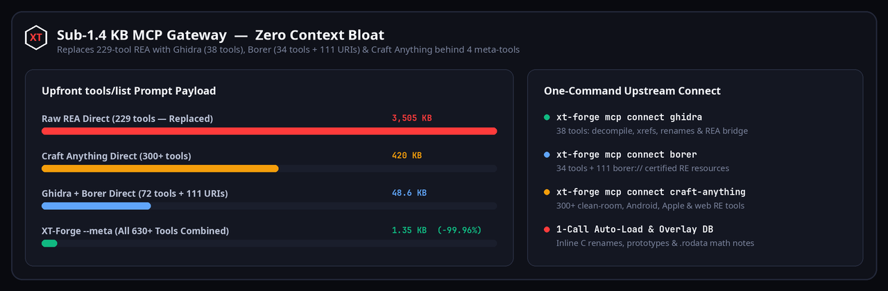

<div align="center">
  
  <h1>xt-forge</h1>
  <p><strong>Local agent workbench for call-graph context, offline reverse engineering, keyless CVE intel, and sub-1KB MCP routing.</strong></p>
  <p>Built in Rust, Go, and zero-dependency Python.</p>
</div>


---

## Why Use xt-forge

Most coding and security agent setups burn thousands of context tokens on massive tool schemas, blind grep searches, and dead-end retries. `xt-forge` puts a fast, local workbench on your PATH with native Rust/Go performance and zero third-party runtime dependencies:

| Everyday Problem | What `xt-forge` Gives You | Command |
| --- | --- | --- |
| Bloated MCP catalogs eat 10K+ tokens per turn | `--meta` gateway exposes 4 meta-tools (`0.90 KB`) wrapping 50 local tools | `xt-forge --meta` |
| Regex grep misses callers, callees, and definitions | Incremental call graph and LSP multiplexer pack structural slices | `xt-forge code index .` |
| Binary triage usually drags in heavy GUI tools | Offline ELF/PE/Mach-O headers, `checksec`, `capa`, RTTI, CFG, XOR, ASAR, APK, HAR | [CVE & RE Guide](docs/CVE-AND-REVERSE-ENGINEERING.md) |
| Threat lookups stall behind API keys or rate limits | Keyless NVD, FIRST EPSS, CISA KEV, InternetDB, GreyNoise, and CIRCL | `xt-forge intel cve CVE-2024-3094` |
| Agents repeat failed fixes or claim done unverified | Negative failure memory, drift checks, and command-backed `goal verify` | [MCP & Steering Guide](docs/MCP-GATEWAY-AND-STEERING.md) |
| External MCP servers mutate schemas or inject prompts | SHA-256 trust pinning (`mcp audit`), guard proxy, and injection scanning | `xt-forge mcp audit` |

---

## Install on Windows, Linux, and macOS

### Option 1: Universal `npx` Setup (Windows, Linux, macOS)

Node.js (`18+`) installs global `xt-forge`, `xtf`, `/xtf` slash commands, and all 18 `XTF-*` skills in one step:

```sh
npx xt-forge@latest init
```

### Option 2: Native One-Line Install (Builds Rust + Go + Links PATH)

**Linux & macOS (Bash / Zsh):**

```sh
# Piped one-liner:
curl -fsSL https://raw.githubusercontent.com/XtrComSu/xt-forge/main/install.sh | bash

# Or from a local clone:
git clone https://github.com/XtrComSu/xt-forge.git && cd xt-forge && ./install.sh
```

**Windows (PowerShell 5.1+ / PowerShell 7+):**

```powershell
# Piped one-liner:
irm https://raw.githubusercontent.com/XtrComSu/xt-forge/main/install.ps1 | iex

# Or from a local clone:
git clone https://github.com/XtrComSu/xt-forge.git; cd xt-forge; .\install.ps1
```

Both `install.sh` and `install.ps1` compile Rust (`xtforge-native`) and Go (`xtforge-hub`) when toolchains are present and fall back cleanly to zero-dependency Python 3.11+ (`XT_FORCE_PYTHON=1` forces Python anytime). Prebuilt release archives and wheels are published on [Releases](https://github.com/XtrComSu/xt-forge/releases).

```sh
xt-forge --meta        # stdio MCP gateway (xt_discover, xt_schema, xt_call, xt_batch)
xt-forge doctor        # check workspace health, guard mode, and native engines
xt-forge skills        # list the 18 bundled XTF-* workflow skills
```

---

## Agent Self-Install Prompts

Want an AI coding agent (Claude Code, Codex CLI, OpenCode, DSH, Cursor) to install and configure `xt-forge` itself? Paste this prompt directly to the agent, or print the full prompt suite via `npx xt-forge prompt-install` (see [prompts/install.md](prompts/install.md)):

> Install `xt-forge` (`https://github.com/XtrComSu/xt-forge`) for this OS (`./install.sh` on Linux/macOS, `.\install.ps1` on Windows PowerShell, or `npx xt-forge@latest init`), verify `xt-forge`, `xtf`, `/xtf`, and all 18 `XTF-*` skills are installed, register `xt-forge --meta` in the active MCP config if one exists, and run `xt-forge version --json` + `xt-forge doctor --json` + `tools/list` on `xt-forge --meta` to prove the setup works.

---

## 3-Tier Workflow Skills (`XTF-*`)

`xt-forge init` syncs **18 structured workflow skills** across three tiers into `~/.agents/skills`, `~/.dsh/skills`, `~/.config/opencode/skills`, and `~/.claude/skills` so models pick exact commands instead of guessing:

| Tier | Count | Skills | Scope |
| --- | ---: | --- | --- |
| **Simple** | 6 | `XTF-RepoMap`, `XTF-CallGraph`, `XTF-Notes`, `XTF-SecretScan`, `XTF-LogCompress`, `XTF-CVELookup` | Workspace maps, call graphs, flash notes, secret/injection scans, log compression, keyless CVE lookup |
| **Complex** | 6 | `XTF-BinaryTriage`, `XTF-Disasm`, `XTF-IOCIntel`, `XTF-BinaryPatch`, `XTF-Unpack`, `XTF-DeepResearch` | Offline ELF/PE triage, disassembly/CFG/RTTI, IOC enrichment, guarded patching, ASAR/APK/HAR unpack, parallel research |
| **Advanced** | 6 | `XTF-Decompile`, `XTF-MCPGateway`, `XTF-BugFix`, `XTF-CrashTriage`, `XTF-GoalLoop`, `XTF-MemoryEval` | String decoding, decompilation, MCP rug-pull defense, bug fixes, minidump postmortem, bounded verification loops |

Full reference and trigger patterns live in [docs/SKILLS.md](docs/SKILLS.md).

---

## Harness Integrations

Drop-in configurations, slash commands (`/xtf --meta`), and tailored setup walkthroughs are included for each major agent harness:

| Harness | Folder | Integration Highlights |
| --- | --- | --- |
| **DSH** | [integrations/dsh/](integrations/dsh/) | Native `/xtf --meta` command prompt, `mcp-patch.json`, profile-aware `cordis` setup |
| **OpenCode** | [integrations/opencode/](integrations/opencode/) | `opencode.json` + native `/xtf`, `/taste`, `/goal`, `/loop` TypeScript plugin |
| **Codex CLI** | [integrations/codex/](integrations/codex/) | Clean `config.toml` entry + compact `AGENTS.md` workflow rules |
| **Claude Code** | [integrations/claude-code/](integrations/claude-code/) | Project `.mcp.json`, `CLAUDE.md`, and `/xtf` slash command integration |

---

## Lean MCP Setup

Wire `xt-forge` once using `--meta`. Models discover tools on demand (`xt_discover` -> `xt_schema` -> `xt_call` or `xt_batch`), keeping initial prompt schema size at **0.90 KB** (`94%` smaller than mounting all 50 individual schemas upfront) and spilling large outputs cleanly to `$XT_HOME/cache/artifacts/`.

It also connects and proxies **REA** ([`morluto/rea`](https://github.com/morluto/rea), 229 RE tools) and **Craft Anything** ([`storytold/craft-anything`](https://github.com/storytold/craft-anything), dynamic `enable_toolset` / `--all-tools`) behind persistent stdio sessions and rug-pull schema pinning:

```sh
# Connect & trust-pin REA or Craft Anything once (populates lazy xt_discover cache)
xt-forge mcp connect rea --json
xt-forge mcp connect craft-anything --json

# Or mount a single trusted proxy directly (auto-refreshes dynamic toolsets)
xt-forge mcp proxy --server rea
xt-forge mcp proxy --server craft-anything
```

```json
{
  "mcpServers": {
    "xt-forge": {
      "command": "xt-forge",
      "args": ["--meta"]
    }
  }
}
```



---

## Common Commands

```sh
# Keyless CVE + Exploit + IOC Triage
xt-forge intel cve CVE-2024-3094 --json
xt-forge re checksec payload.elf --json
xt-forge re capa payload.elf --json
xt-forge re ioc payload.elf --json

# Incremental Symbol Call Graph & Context Packing
xt-forge code index .
xt-forge code graph verify_sig . --depth 2 --json
xt-forge route context . --query "verify_sig" --symbols --token-budget 1200

# Guardrails, Failure Memory & Security Scanning
xt-forge guard mode explore|ask|auto
xt-forge mem search "TLS" --k 3 --json
xt-forge scan secrets .
xt-forge mcp audit --server upstream --cmd "npx -y @org/server" --trust-on-first
```

---

## Native Performance

Hot CLI paths run directly in Rust (`xtforge-native`) and Go (`xtforge-hub`), delivering 10x to 25x speedups over `XT_FORCE_PYTHON=1` on cold subprocess invocations (median of 5 runs):

| Workload | Native Engine | Native (ms) | Python (ms) | Speedup |
| --- | --- | ---: | ---: | ---: |
| `scan secrets xtforge` | Rust | 28.2 | 327.2 | 11.6x |
| `route context xtforge --symbols` | Rust | 15.3 | 162.8 | 10.7x |
| `code index xtforge` | Rust | 6.9 | 122.9 | 17.9x |
| `codec entropy <elf>` | Rust | 7.7 | 197.5 | 25.8x |
| `re checksec <elf>` | Go | 8.8 | 120.6 | 13.7x |
| `re capa <elf>` | Go | 18.3 | 313.9 | 17.2x |
| `intel sources` | Go | 6.0 | 109.3 | 18.2x |

Full dispatch details live in [docs/ARCHITECTURE-RUST-GO.md](docs/ARCHITECTURE-RUST-GO.md).

---

## Documentation


- [Field Guide & Architecture Walkthrough](docs/GUIDE.md)
- [CVE Research and Reverse Engineering Deep Dive](docs/CVE-AND-REVERSE-ENGINEERING.md)
- [3-Tier Skills Reference (`XTF-*`)](docs/SKILLS.md)
- [MCP Meta-Gateway and Steering](docs/MCP-GATEWAY-AND-STEERING.md)
- [Rust + Go Hybrid Runtime Details](docs/ARCHITECTURE-RUST-GO.md)
- [RE Workbench Details](docs/RE-WORKBENCH.md)
- [0.4.0 Release Notes](docs/RELEASE-0.4.0.md)

## Tests

```sh
cd native/xtforge-rs && cargo test && cd ../..
cd native/xtforge-go && go test -race ./... && cd ../..
python3 -m unittest discover -s tests
node --test plugins/xt-native/test/*.test.mjs
python3 scripts/verify_artifact.py && python3 scripts/verify_dedup_matrix.py && python3 scripts/verify_knowledge.py && python3 scripts/verify_recall.py
```

MIT Licensed.
