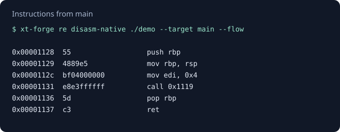
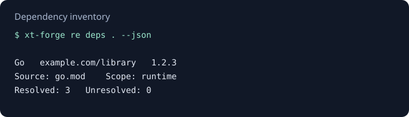
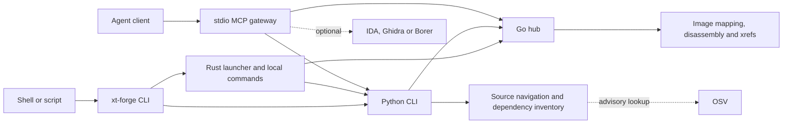

<div align="center">
  <h1>xt-forge</h1>
  <p>Binary inspection, code navigation, and an MCP gateway.</p>
  <p>
    <a href="#install">Install</a> ·
    <a href="#binary-inspection">Binary inspection</a> ·
    <a href="#dependency-and-advisory-checks">Dependencies</a> ·
    <a href="#mcp">MCP</a> ·
    <a href="CHANGELOG.md">Changelog</a>
  </p>
</div>

xt-forge reads ELF, Windows PE, and Mach-O binaries from the command line. Use it to list functions, follow calls and cross-references, inspect symbols, and compare builds. The same CLI inventories software dependencies, checks pinned versions against OSV, and traces callers and runtime dispatch in source trees. Agents can use these tools over stdio MCP.

This is the **0.4.8 private preview**. The [changelog](CHANGELOG.md) records the changes since 0.4.7.


## Install

Use Python 3.11 or newer. The source installers build the Rust and Go components when their toolchains are available. Native analysis commands such as `re overview` and `re disasm-native` require the Go hub.

### Linux and macOS

From a checkout:

```sh
bash install.sh
export PATH="$HOME/.local/bin:$PATH"
xt-forge doctor --json
```

### Windows

From a checkout in PowerShell:

```powershell
.\install.ps1
xt-forge doctor --json
```

If Windows finds the wrong Python, set `$env:XT_PYTHON` to the full path of a Python 3.11+ executable before running `install.ps1`. The installer adds the launcher directory to the user PATH. Windows and macOS install scripts still need execution checks on their target OS.

### Release archives

The release builder targets Linux x86-64 and arm64, macOS x86-64 and arm64, and Windows x64. Each platform bundle is intended to carry the Go hub. The builder can include the Rust launcher for its host target. See [release downloads](https://github.com/XtrComSu/xt-forge-dev/releases) for any attached archives and their SHA-256 checksums.

Extract the archive and run these commands from the extracted directory. Add its `bin` directory to the current session's PATH so that the launcher can find the bundled hub.

**Linux and macOS**

```sh
export PATH="$PWD/bin:$PATH"
./bin/xtforge version --json
./bin/xtforge re overview ./bin/xtforge-hub --json
```

**Windows**

```powershell
$env:Path = (Join-Path (Get-Location) 'bin') + ';' + $env:Path
.\bin\xtforge.cmd version --json
.\bin\xtforge.cmd re overview .\bin\xtforge-hub.exe --json
```

For the Python CLI alone, run `uv tool install .` from the source checkout, then use `xtforge`. The Python package relies on a separate Go hub for native analysis.

## Binary inspection

```sh
xt-forge re overview ./app --json
xt-forge re functions ./app --limit 20 --json
xt-forge re disasm-native ./app --target main --flow --json
xt-forge re xrefs-native ./app --target main --json
```

Replace `./app` and `main` with the file and function you want to inspect. For a universal Mach-O, use `--arch` to select a slice. For an IPA, use `--member` to select the app executable.

| Input | What you can inspect |
| --- | --- |
| ELF | Segments, sections, dependencies, symbol versions, function starts, and references to imports and data |
| Windows PE | EXE and DLL headers, imports, exports, resources, and CodeView debug records. Load a matching PDB to recover names and types. |
| Mach-O | Thin and universal images, per-slice metadata, function starts, Objective-C metadata, and selected hardening flags |
| Containers and managed files | IPA, DMG, static archives, APK/DEX, .NET metadata, and Unity IL2CPP metadata |
| Firmware and filesystems | UEFI volumes and file entries, Android boot and OTA metadata, and NTFS transaction records |
| Other files | File size, SHA-256, entropy, and bounded hex and string previews |

Decoding and structured pseudocode have different coverage. Native decoding includes x86, x86-64, arm64, and selected ARM32 and Thumb instructions. Structured pseudocode covers supported x86-64 and arm64 functions and reports why recovery stops when it cannot proceed. See the [workbench guide](docs/RE-WORKBENCH.md) for commands and format details.

### Follow a call through an ELF binary

Compile a small C program with symbols to try the native decoder. This example needs a C compiler and the Go hub.

```sh
cat > demo.c <<'EOF'
int increment(int n) { return n + 1; }
int main(void) { return increment(4); }
EOF
cc -g -O0 demo.c -o demo
xt-forge re disasm-native ./demo --target main --flow
xt-forge re xrefs-native ./demo --target increment --json
```



[Raw CLI output](docs/assets/release-review/disassembly.txt)

The Electron fuse reader reports known settings and leaves unknown states visible. The source tree also includes Interface Builder archive inspection and Chromium-based WebMCP discovery. [Electron fixture](docs/assets/session-captures/07-fuses.txt) · [Interface Builder fixture](docs/assets/session-captures/08-nib.txt) · [WebMCP example](docs/assets/session-captures/09-webmcp.txt) · [NTFS fixture](docs/assets/session-captures/11-ntfs.txt)

## Dependency and advisory checks

These commands are available in the current source tree:

```sh
xt-forge re deps .
xt-forge re vulns .
xt-forge re remediate .
```

`re deps` reads dependency manifests and supported compiled metadata, including Go build information. `re vulns` sends resolved package names and versions to OSV and checks the advisory's affected ranges. Unresolved version ranges stay in the inventory without an advisory lookup. `re cve-info` shows a single advisory by ID.



[CLI transcript](docs/assets/release-review/dependencies.txt)

`re remediate` previews proposed version changes. Add `--write` to apply supported edits. The command verifies each candidate file before writing and retains an `.xtbak` copy of a changed file. Review the diff and run your package manager and tests before merging. [Example plan](docs/assets/session-captures/03-remediate-dry.txt)

## Source navigation

```sh
xt-forge route context . --query "where is the request routed?" --json
xt-forge callers dispatch_request . --json
xt-forge trace dispatch_request . --json
```

Use context search to collect relevant source, `callers` to trace references, and `trace` to follow re-exports and configured dispatch. See the [CLI guide](docs/GUIDE.md) and the [skill catalog](skills/README.md).

## MCP

```sh
xt-forge --meta
```

Register that command as a stdio MCP server in your client. The compact catalog exposes four tools:

| Tool | Use |
| --- | --- |
| `xt_discover` | Find tools by name or task |
| `xt_schema` | Read the argument schema for a selected tool |
| `xt_call` | Run a tool |
| `xt_batch` | Submit several tool calls |

The gateway can connect to upstream tools such as Ghidra, IDA, and Borer when those backends are configured. See [MCP setup](docs/MCP-GATEWAY-AND-STEERING.md) and the [client configurations](integrations/).

## Runtime and dispatch



Most file and source commands work offline. Advisory lookup contacts OSV. Backends you configure separately have their own runtime and data requirements. The JSON output identifies the engine where the command exposes it.

## Benchmarks

The recorded 0.4.7 ELF and PE benchmark passed 70 of 70 checks against reference tools or known fixture results. A separate agent evaluation on 0.4.6 completed 42 of 45 tasks with standalone xt-forge and 10 of 45 with REA 6.7.0 on the same model and harness. [Methodology and results](docs/BENCHMARKS.md)

## Development

From the repository root:

```sh
(cd native/xtforge-rs && cargo test --locked)
(cd native/xtforge-go && go test -race ./...)
python3 -m unittest discover -s tests
node --test plugins/xt-native/test/*.test.mjs
python3 scripts/verify_sys_native.py
```

The Go suite includes an HTTP test that needs loopback sockets. The cross-format verifier needs a C compiler, Clang, LLD, MinGW, and LLVM tools. See [runtime architecture](docs/ARCHITECTURE-RUST-GO.md) for build and verifier details. Run `python3 scripts/render_readme_diagrams.py` to regenerate the SVG figures.

[MIT License](LICENSE) · [XT-OSS](https://xtrcom.xyz)
