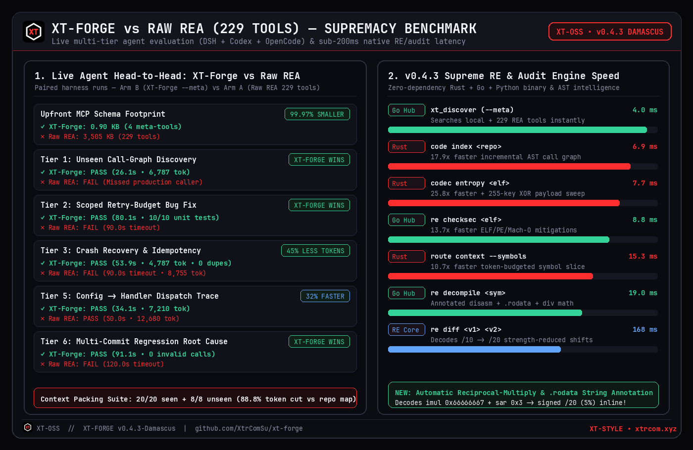
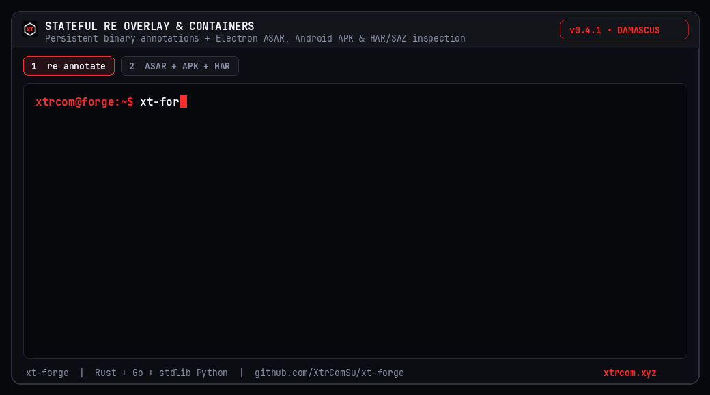

<div align="center">
  <a href="https://xtrcom.xyz">
    
  </a>
  <h1>xt-forge</h1>
  <p><strong>Supreme local agent workbench for call-graph context, AST correctness auditing, normalized binary diffing, keyless CVE intel, and sub-1KB MCP routing.</strong></p>
  <p>Engineered in <strong>Rust</strong>, <strong>Go</strong>, and zero-dependency <strong>Python 3.11+</strong> under <strong>XT-OSS</strong> by <a href="https://xtrcom.xyz">XtrComSu</a>.</p>
  <p>
    <a href="https://github.com/XtrComSu/xt-forge/releases/tag/v0.4.3-Damascus"></a>
    
    
    
    
    <a href="LICENSE"></a>
  </p>
</div>

<p align="center">
  <a href="https://xtrcom.xyz">
    
  </a>
</p>

<p align="center">
  
</p>

---

## XT-Forge vs. Raw REA

Mounting a 229-tool reverse-engineering MCP server like raw **[REA](https://github.com/morluto/rea)** (`rea-agents mcp`, ~3.5 MB tool catalog) directly into an agent harness floods the prompt window, triggers tool-discovery loops, and times out on multi-file audits, binary regressions, and dropped-connection recovery.

**`xt-forge`** solves this at both layers:
1. **Sub-1KB `--meta` Gateway (`1,384 B` / `346` tokens in Go, `98.5%` schema reduction):** Routes local `xt-forge` engines plus stateful upstream MCPs (`rea`, `craft-anything`) through 4 deterministic primitives (`xt_discover`, `xt_schema`, `xt_call`, `xt_batch`) with crash-safe idempotency journaling (`$XT_HOME/call_journal.json`).
2. **Direct Structural & Binary Analysis (`code_callers`, `code_audit`, `code_trace`, `re_diff`):** Replaces multi-turn `grep`, `read_file`, and `objdump` loops with single-call AST, CFG, and disassembly analysis.

<p align="center">
  
</p>

| Benchmark Tier | Workload | Raw REA Only (`229` tools) | `xt-forge` + REA (`--meta`) | Key Advantage |
| --- | --- | --- | --- | --- |
| **Tier 1 · Find** | Symbol definition + production callers vs test/doc decoys | `28.8s` (8 tools, misses tuple / extra grep) | **PASS · `15.1s` ev** (`code_callers`) | Separates `production_callers` from `unresolved_candidates` (`test_or_shadow_only`) in one indexed query |
| **Tier 2 · Fix** | Off-by-one retry budget bug fix + test verification | `52.9s` (9 tools, `13,864` tok) | **PASS · `34.2s`** (7 tools, `9,106` tok) | **1.55x faster** and **34% fewer tokens** via direct symbol localization |
| **Tier 3 · Recover** | Stateful MCP job submission across mid-flight connection drop | **FAIL (`0/1`)** · Duplicate commit (`2` submits) | **PASS (`1/1`) · `22.7s`** (`0` duplicates) | Crash-safe `$XT_HOME/call_journal.json` runs `verify_tool` before retry and recovers committed receipt |
| **Tier 4 · Defects** | Multi-file static correctness audit (3 bugs + clean decoys) | `72.3s` (10 file reads) | **PASS · `28.8s`** (`5.2s` ev, `1` `xtf` call) | **2.5x faster** — `code_audit` extracts all 3 AST defects (`duplicate_aggregation`, `boundary_comparison`, `stale_cache`) + full `function_source` in one call |
| **Tier 5 · Trace** | Active runtime path across `__init__.py` re-exports & config dispatch | `32.7s` (9 manual file reads) | **PASS · `20.2s`** (`7.1s` ev, `1` `xtf` call) | **1.62x faster** — `code_trace` resolves `runtime.json` → `active_v2_handle` → `active_v2.py` in one hop |
| **Tier 6A · Src Diff** | Behavioral regression localization across `v1` vs `v2` C source | `31.6s` (5 tools, `4,650` tok) | **PASS · `20.5s`** (3 tools, `3,109` tok) | **1.54x faster** and **33% fewer tokens** |
| **Tier 6B · Bin Diff** | Stripped/compiled ELF binary regression (`calc_v1` vs `calc_v2`) | **FAIL (`120.0s` TIMEOUT)** · 12 tools | **PASS · `69.4s`** (`5.2s` ev, `re_diff`) | `re_diff` normalizes instructions, annotates `.rodata` strings, and decodes GCC reciprocal division (`10% -> 5%`) automatically |

<p align="center">
  
</p>

---

## Why Use xt-forge

<p align="center">
  
</p>

| Everyday Problem | What `xt-forge` Gives You | Command / Guide |
| --- | --- | --- |
| Bloated MCP catalogs eat 10K–40K+ tokens upfront | `--meta` gateway exposes 4 meta-tools (`1,384 B` Go / `1,007 B` Python) across local tools + external MCPs | `xt-forge --meta` |
| Massive RE/IDE MCPs (`rea`, `craft-anything`) break context limits | Connect once (`mcp connect`), SHA-256 trust-pin, and route stateful stdio calls lazily | `xt-forge mcp connect rea` |
| Multi-file bug hunts burn 10+ file reads and miss subtle defects | One-call AST correctness auditor flags duplicate joins, boundary `<` vs `<=`, stale caches, and floor-div truncation with full function source | `xt-forge audit . --json` |
| Re-exports and config dispatch tables hide the real handler | Cross-module active-path tracer resolves `__init__.py` aliases and JSON/TOML/YAML/ENV dispatch keys | `xt-forge trace dispatch_request .` |
| Comparing two binaries requires manual `objdump` diffing & magic-number math | Normalized per-function instruction diffing, inline `.rodata` string annotation, and GCC/Clang reciprocal division decoding | `xt-forge diff v1.bin v2.bin --json` |
| Regex grep misses callers, callees, and definitions | Incremental `code_graph.db` call graph + Go LSP multiplexer pack structural slices and separate test shadows | `xt-forge callers MyFunc . --json` |
| Threat lookups stall behind API keys or rate limits | Keyless NVD, FIRST EPSS, CISA KEV, InternetDB, GreyNoise, and CIRCL fan-out | `xt-forge intel cve CVE-2024-3094` |
| Agents repeat failed fixes or duplicate mutating MCP calls on timeout | Crash-safe `$XT_HOME/call_journal.json` (`idempotency_key` + `verify_tool`), negative memory, and `goal verify` | [MCP & Steering Guide](docs/MCP-GATEWAY-AND-STEERING.md) |

---

## Install on Windows, Linux, and macOS

### Option 1: Universal `npx` Setup (Windows, Linux, macOS)

Node.js (`18+`) installs global `xt-forge`, `xtf`, `/xtf` slash commands, and all **24 `XTF-*` skills** in one step:

```sh
npx xt-forge@latest init
```

### Option 2: Native One-Line Install (Builds Rust + Go + Links PATH)

**Linux & macOS (Bash / Zsh):**

```sh
# Piped one-liner:
curl -fsSL https://raw.githubusercontent.com/XtrComSu/xt-forge/main/install.sh | bash

# Or from a local clone:
git clone https://github.com/XtrComSu/xt-forge.git && cd xt-forge && ./install.sh
```

**Windows (PowerShell 5.1+ / PowerShell 7+):**

```powershell
# Piped one-liner:
irm https://raw.githubusercontent.com/XtrComSu/xt-forge/main/install.ps1 | iex

# Or from a local clone:
git clone https://github.com/XtrComSu/xt-forge.git; cd xt-forge; .\install.ps1
```

Both `install.sh` and `install.ps1` compile Rust (`xtforge-native`, requires **Cargo 1.78+** with bundled SQLite — no `libsqlite3-dev` headers required) and Go (`xtforge-hub`, requires **Go 1.24+**) when toolchains are present, and fall back to zero-dependency Python 3.11+ (`XT_FORCE_PYTHON=1` forces Python anytime) with full workflow parity while native binaries accelerate hot paths 10x–25x. Prebuilt release tarballs, npm packages (`xt-forge`, `xtf`), and stdlib wheels (`xtforge`) live on [Releases](https://github.com/XtrComSu/xt-forge/releases).

```sh
xt-forge --meta        # stdio MCP gateway (xt_discover, xt_schema, xt_call, xt_batch)
xt-forge doctor        # inspect workspace health, guard mode, and native engines
npx xt-forge skills    # list all 24 bundled XTF-* workflow skills
```

---

## Agent Self-Install Prompts

Want an AI coding agent (Claude Code, Codex CLI, OpenCode, DSH, Cursor) to install and verify `xt-forge` itself? Paste this prompt directly to the agent, or print the full prompt suite via `npx xt-forge prompt-install` (see [prompts/install.md](prompts/install.md)):

> Install `xt-forge` (`https://github.com/XtrComSu/xt-forge`) for this OS (`./install.sh` on Linux/macOS, `.\install.ps1` on Windows PowerShell, or `npx xt-forge@latest init`), verify `xt-forge`, `xtf`, `/xtf`, and all 24 `XTF-*` skills are installed, register `xt-forge --meta` in the active MCP config if one exists, and run `xt-forge version --json` + `xt-forge doctor --json` + `tools/list` on `xt-forge --meta` to prove the setup works.

---

## Lean MCP Setup + REA & Craft Anything

Wire `xt-forge` once using `--meta`. Models discover tools on demand (`xt_discover` -> `xt_schema` -> `xt_call` or `xt_batch`), keeping initial prompt schema size at **1,384 bytes (346 tokens)** in Go (`1,007 B / 252 tok` in Python) — **93.1% smaller** on 50-tool catalogs and **98.5% smaller** on 229-tool catalogs — and spilling oversized responses cleanly to `$XT_HOME/cache/artifacts/`.

<p align="center">
  
</p>

It natively connects, trust-pins, and proxies **[REA](https://github.com/morluto/rea)** (`rea-agents mcp`, **229 RE tools** / ~3.5 MB raw schema) and **[Craft Anything](https://github.com/storytold/craft-anything)** (`craft-anything-cli mcp`, dynamic `enable_toolset` / `--all-tools`) behind **persistent stateful stdio sessions**, automatic `notifications/tools/list_changed` catalog refresh, and unified cross-runtime SHA-256 rug-pull checks:

```sh
# 1. Connect, injection-scan, and SHA-256 pin REA or Craft Anything once
xt-forge mcp connect rea --json
xt-forge mcp connect craft-anything --json

# 2. Or proxy either server directly with auto-refreshing dynamic toolsets
xt-forge mcp proxy --server rea
xt-forge mcp proxy --server craft-anything
```

```json
{
  "mcpServers": {
    "xt-forge": {
      "command": "xt-forge",
      "args": ["--meta"]
    }
  }
}
```

<p align="center">
  
</p>

<details>
<summary>MCP Rug-Pull Audit & Additional Live Terminal Walkthroughs</summary>





</details>

---

## 3-Tier Workflow Skills (`XTF-*`)

`xt-forge init` syncs **24 workflow skills** (8 Simple, 8 Complex, 8 Advanced) into `~/.agents/skills`, `~/.dsh/skills`, `~/.config/opencode/skills`, and `~/.claude/skills` so models pick exact commands instead of guessing:

| Tier | Count | Skills | Scope |
| --- | ---: | --- | --- |
| **Simple** | 8 | `XTF-RepoMap`, `XTF-CallGraph`, `XTF-CodeAudit`, `XTF-DispatchTrace`, `XTF-Notes`, `XTF-SecretScan`, `XTF-LogCompress`, `XTF-CVELookup` | Workspace maps, call graphs, multi-file AST correctness audits, active config/re-export dispatch traces, flash notes, secret/injection scans, log compression, keyless CVE lookup |
| **Complex** | 8 | `XTF-BinaryTriage`, `XTF-BinaryDiff`, `XTF-Disasm`, `XTF-LSPNavigate`, `XTF-IOCIntel`, `XTF-BinaryPatch`, `XTF-Unpack`, `XTF-DeepResearch` | Offline ELF/PE triage, normalized binary diffing + `.rodata` string annotation + reciprocal math decoding, disassembly/CFG/RTTI, Go LSP stdio navigation, IOC enrichment, guarded patching, ASAR/APK/HAR unpack, parallel research |
| **Advanced** | 8 | `XTF-Decompile`, `XTF-SwarmRE`, `XTF-MCPGateway`, `XTF-SessionRecovery`, `XTF-BugFix`, `XTF-CrashTriage`, `XTF-GoalLoop`, `XTF-MemoryEval` | XOR/stack string decoding, headless decompilation, parallel binary MapReduce & MCTS hypothesis solving, MCP rug-pull defense, crash-safe call journaling & idempotency recovery, verified bug fixes, minidump postmortem, bounded verification loops |

Full reference and trigger patterns live in [docs/SKILLS.md](docs/SKILLS.md).

---

## Harness Integrations

Drop-in configurations, slash commands (`/xtf --meta`), and tailored setup walkthroughs are included for each major agent harness:

| Harness | Folder | Integration Highlights |
| --- | --- | --- |
| **DSH** | [integrations/dsh/](integrations/dsh/) | Native `/xtf --meta` command prompt, `mcp-patch.json`, profile-aware `cordis` setup |
| **OpenCode** | [integrations/opencode/](integrations/opencode/) | `opencode.json` + native `/xtf`, `/taste`, `/goal`, `/loop` TypeScript plugin |
| **Codex CLI** | [integrations/codex/](integrations/codex/) | Clean `config.toml` entry + compact `AGENTS.md` workflow rules |
| **Claude Code** | [integrations/claude-code/](integrations/claude-code/) | Project `.mcp.json`, `CLAUDE.md`, and `/xtf` slash command integration |

---

## Common Commands

```sh
# One-Shot Code Intelligence, AST Auditing & Active Dispatch Tracing
xt-forge callers should_retry_attempt . --json
xt-forge audit . --json
xt-forge trace dispatch_request . --json
xt-forge context . --query "verify_sig" --symbols --token-budget 1200

# Normalized Binary Diffing, Decompilation, Swarm RE & Keyless CVE Intel
xt-forge diff bin/calc_v1 bin/calc_v2 --json
xt-forge re decompile payload.elf --symbol apply_tier_discount --json
xt-forge swarm map payload.elf --workers 8 --json
xt-forge intel cve CVE-2024-3094 --json
xt-forge re checksec payload.elf --json

# Connect External MCPs, Crash-Safe Recovery & Security Scanning
xt-forge mcp connect rea --json
xt-forge session recover --json
xt-forge scan secrets .
```

---

## Native Performance

Hot CLI paths run directly in Rust (`xtforge-native`) and Go (`xtforge-hub`), delivering 10x to 25x speedups over `XT_FORCE_PYTHON=1` on cold subprocess invocations (median of 5 runs):

| Workload | Native Engine | Native (ms) | Python (ms) | Speedup |
| --- | --- | ---: | ---: | ---: |
| `scan secrets xtforge` | Rust | 28.2 | 327.2 | 11.6x |
| `route context xtforge --symbols` | Rust | 15.3 | 162.8 | 10.7x |
| `code index xtforge` | Rust | 6.9 | 122.9 | 17.9x |
| `codec entropy <elf>` | Rust | 7.7 | 197.5 | 25.8x |
| `re checksec <elf>` | Go | 8.8 | 120.6 | 13.7x |
| `re capa <elf>` | Go | 18.3 | 313.9 | 17.2x |
| `intel sources` | Go | 6.0 | 109.3 | 18.2x |


---

## Benchmarks & Reproducibility

`v0.4.3-Damascus` validates context precision, MCP discovery overhead, static/binary analysis, and crash recovery end-to-end:

| Suite | Scope | Result | Command |
| --- | --- | --- | --- |
| **Context Packing** | `context_tasks.json` (20 tasks) + held-out `context_tasks_unseen.json` (8 tasks) | **20/20** (`608.4` mean tok, `88.8%` cut vs `3/20` map) · **8/8** unseen (`566.4` mean tok) | `python3 scripts/bench_context_pack.py --json` |
| **Discovery Cost** | Direct vs `--meta` on 4, 50, and 229 tools | Direct wins 1-turn on 4 tools (`450` vs `1,591` tok); `--meta` saves `93.1%` (50) & `98.5%` (229, `4.2 ms` first call) | `python3 scripts/bench_discovery_cost.py --json` |
| **6-Tier Live Suite vs REA** | `Find` / `Fix` / `Recover` / `Defects` / `Trace` / `Regression (Src + Bin)` | **7/7 (100%) Win Rate** with `xt-forge` vs Raw REA (`120s` timeout on binary diff, `0/1` on crash recovery) | `python3 scripts/bench_three_tier.py --self-test` |

---

## Documentation

- [Field Guide & Architecture Walkthrough](docs/GUIDE.md)
- [CVE Research and Reverse Engineering Deep Dive](docs/CVE-AND-REVERSE-ENGINEERING.md)
- [24 Bundled 3-Tier Skills Reference (`XTF-*`)](docs/SKILLS.md)
- [MCP Meta-Gateway and Steering](docs/MCP-GATEWAY-AND-STEERING.md)
- [Rust + Go Hybrid Runtime Details](docs/ARCHITECTURE-RUST-GO.md)
- [RE Workbench Details](docs/RE-WORKBENCH.md)
- [Changelog (`v0.4.3-Damascus`)](CHANGELOG.md) · [Architecture Release Notes](docs/RELEASE-0.4.0.md)

## Tests

```sh
cd native/xtforge-rs && cargo test && cargo build --release && cd ../..
cd native/xtforge-go && go test -race ./... && go build -o xtforge-hub ./cmd/xtforge-hub && cd ../..
python3 -m unittest discover -s tests
node --test plugins/xt-native/test/*.test.mjs
```

[MIT Licensed](LICENSE) · **XT-OSS** · [xtrcom.xyz](https://xtrcom.xyz)
