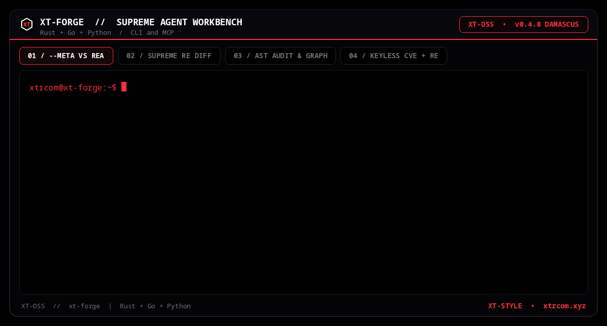
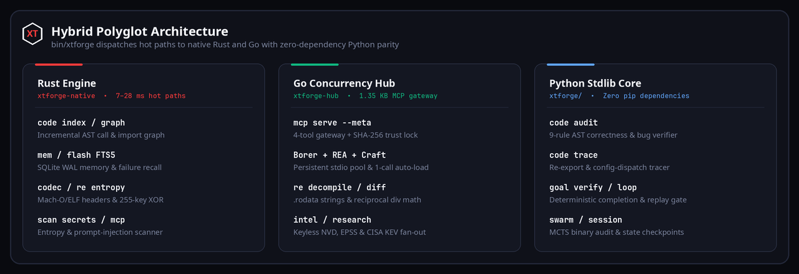

# xt-forge

A fast local workbench for coding agents and security researchers. It replaces bloated 200-tool MCP servers, noisy grep loops, and blind binary guessing with one hybrid runtime built in **Rust**, **Go**, and **zero-dependency Python**.



**Full educational walkthroughs (1080p-crisp MP4):**
- [xtforge-overview.mp4](docs/videos/xtforge-overview.mp4): why `xt-forge` exists, lean MCP routing, CVE triage, RE analysis, and call graphs
- [cve-re-workflow.mp4](docs/videos/cve-re-workflow.mp4): end-to-end sample triage from `re checksec` and XOR recovery to `intel cve` and Ghidra export

---

## What It Solves

| Problem with standard agent setups | What `xt-forge` gives you | Where to start |
| --- | --- | --- |
| Mounting dozens of MCP tools eats 8k to 16k tokens per turn | `--meta` gateway exposes 4 tools (`0.90 KB` total) for full 56-tool access | `xtforge mcp serve --meta` |
| Regex search dumps unrelated files instead of callers and callees | Incremental AST/regex call graph expands structurally around symbols | `xtforge code index .` + `--symbols` |
| Static/binary reverse engineering usually needs heavy GUI setups | Local ELF/PE/Mach-O, XOR recovery, `capa`, RTTI, CFG, ASAR, HAR, APK, and SHA-256 overlays | [CVE & RE Deep Dive](docs/CVE-AND-REVERSE-ENGINEERING.md) |
| CVE and indicator lookups often break behind API keys and signups | Keyless NVD, FIRST EPSS, CISA KEV, Shodan InternetDB, GreyNoise, and CIRCL lookups | `xtforge intel cve CVE-2024-3094` |
| Models retry failed fixes and claim tasks are "done" without running checks | Negative failure memory (`record-failure`), drift checks (`goal check`), and replayable `goal verify` | [MCP & Steering Guide](docs/MCP-GATEWAY-AND-STEERING.md) |
| Silent post-install MCP schema changes or hidden prompt injections | SHA-256 trust pinning (`mcp trust`), schema scanner (`scan mcp`), and output spill cache | `xtforge mcp audit <cmd>` |

---

## Install in 30 Seconds

Requires Python 3.11+ (zero pip dependencies). Rust (`xtforge-native`) and Go (`xtforge-hub`) binaries accelerate hot paths automatically when built.

```sh
git clone <your-repo-url> xt-forge
cd xt-forge

# Optional: build Rust + Go native engines (no external network dependencies)
(cd native/xtforge-rs && cargo build --release)
(cd native/xtforge-go && go build -ldflags="-s -w" -o xtforge-hub ./cmd/xtforge-hub)

# Sanity check
./bin/xtforge version --json
./bin/xtforge doctor --json
```

If native binaries are not built, `./bin/xtforge` falls back seamlessly to pure Python. Force pure Python anytime with `XT_FORCE_PYTHON=1`.

---

## Harness Editions (Plug-and-Play)

Pick your coding harness. Every edition includes drop-in config files, tailormade rules, and its own setup video and preview GIF:

| Harness | Edition Folder | Included Config & Setup | Walkthrough |
| --- | --- | --- | --- |
| **DSH** | [integrations/dsh/](integrations/dsh/) | `mcp-patch.json` + DSH `AGENTS.md` + `cordis` profile injection | [dsh-setup.mp4](integrations/dsh/dsh-setup.mp4) |
| **OpenCode** | [integrations/opencode/](integrations/opencode/) | `opencode.json` + native `/taste`, `/goal`, `/loop` TypeScript plugin | [opencode-setup.mp4](integrations/opencode/opencode-setup.mp4) |
| **Codex CLI** | [integrations/codex/](integrations/codex/) | `~/.codex/config.toml` snippet + compact `AGENTS.md` | [codex-setup.mp4](integrations/codex/codex-setup.mp4) |
| **Claude Code** | [integrations/claude-code/](integrations/claude-code/) | Project `.mcp.json` + `CLAUDE.md` + `mcp trust` hooks | [claude-code-setup.mp4](integrations/claude-code/claude-code-setup.mp4) |

---

## Lean MCP Setup

Run the built-in MCP server either with all **56 individual tools** (`15.1 KB`) or compressed behind the **4-tool `--meta` gateway** (`0.90 KB`, **94.1% smaller**):

```json
{
  "mcpServers": {
    "xt-forge": {
      "command": "/path/to/xt-forge/bin/xtforge",
      "args": ["mcp", "serve", "--meta"]
    }
  }
}
```

In `--meta` mode, models call `xt_discover` -> `xt_schema` -> `xt_call` (or `xt_batch` for up to 10 calls in one turn), with oversized responses automatically spilled to `$XT_HOME/cache/artifacts/` instead of overflowing context.


---

## Common Workflows

### 1. CVE Research and Reverse Engineering

```sh
# Pull CISA KEV + EPSS + NVD details without any API key
./bin/xtforge intel cve CVE-2024-3094 --json
./bin/xtforge intel kev --query openssh --json

# Inspect binaries, mitigations, and obfuscated strings locally
./bin/xtforge re checksec payload.elf --json
./bin/xtforge re capa payload.elf --json
./bin/xtforge re strings payload.elf --xor --min-len 8 --json
./bin/xtforge re ioc payload.elf --json

# Store SHA-256 keyed renames/comments and export to Radare2 or Ghidra
./bin/xtforge re annotate rename payload.elf 0x401820 xor_decode
./bin/xtforge re annotate export payload.elf --format ghidra > ApplyNames.py
```

Read the full guide: **[CVE Research and Reverse Engineering](docs/CVE-AND-REVERSE-ENGINEERING.md)**.

### 2. Symbol-Aware Navigation

```sh
./bin/xtforge code index .
./bin/xtforge code graph check_write_mode --json
./bin/xtforge route context . --query "check_write_mode" --symbols
```

### 3. Steering, Guardrails, and Negative Memory

```sh
# Lock writes during exploration or allow audited edits
./bin/xtforge guard mode explore|ask|auto

# Record a dead end so future searches warn before repeating it
./bin/xtforge mem record-failure --title "Skip TLS verify" --error-sig ERR_TLS --body "Pinned cert required"
./bin/xtforge mem search "TLS" --k 3 --json

# Catch scope drift and verify completion claims before stopping
./bin/xtforge goal check --json
./bin/xtforge scan secrets . --limit 20
```

---

## Documentation



- [Getting Started Guide](docs/GUIDE.md)
- [CVE Research and Reverse Engineering](docs/CVE-AND-REVERSE-ENGINEERING.md)
- [Rust + Go Hybrid Architecture](docs/ARCHITECTURE-RUST-GO.md)
- [RE Workbench Details](docs/RE-WORKBENCH.md)
- [MCP Meta-Gateway and Agent Steering](docs/MCP-GATEWAY-AND-STEERING.md)
- [Draft 0.4.0 Release Notes (Local Preview)](docs/RELEASE-0.4.0.md)

## Tests

```sh
cd native/xtforge-rs && cargo test && cd ../..
cd native/xtforge-go && go test -race ./... && cd ../..
python3 -m unittest discover -s tests
python3 test_artifact.py && python3 test_dedup_matrix.py && python3 test_knowledge.py && python3 test_recall.py
```

MIT Licensed.
