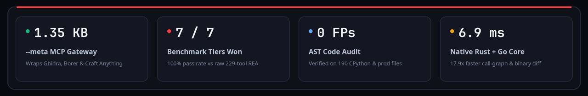
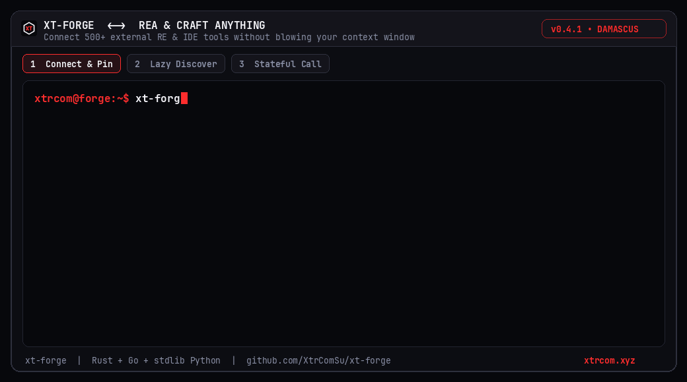

<div align="center">
  <a href="https://xtrcom.xyz">
    
  </a>
  <h1>xt-forge</h1>
  <p><strong>Supreme local agent workbench for call-graph context, AST correctness auditing, normalized binary diffing, keyless CVE intel, and sub-1KB MCP routing.</strong></p>
  <p>Engineered in <strong>Rust</strong>, <strong>Go</strong>, and zero-dependency <strong>Python 3.11+</strong> under <strong>XT-OSS</strong> by <a href="https://xtrcom.xyz">XtrComSu</a>.</p>
  <p>
    <a href="https://github.com/XtrComSu/xt-forge/releases/tag/v0.4.6-Damascus"></a>
    
    
    
    
    <a href="LICENSE"></a>
  </p>
  <p>
    <a href="#install-on-linux-macos-and-windows">Quickstart &amp; Install</a> ·
    <a href="docs/BENCHMARKS.md">9-Tier Benchmarks</a> ·
    <a href="docs/GUIDE.md">CLI &amp; Skills Guide</a> ·
    <a href="docs/MCP-GATEWAY-AND-STEERING.md">MCP Gateway</a> ·
    <a href="https://github.com/XtrComSu/xt-forge/releases/latest">Latest Release</a>
  </p>
</div>

<p align="center">
  <a href="https://xtrcom.xyz">
    
  </a>
</p>

<p align="center">
  
</p>

---

## XT-Forge vs. Raw REA

Mounting a 229-tool reverse-engineering MCP server like raw **[REA](https://github.com/morluto/rea)** (`rea-agents mcp`, ~3.5 MB tool catalog) directly into an agent harness floods the prompt window, triggers tool-discovery loops, and times out on multi-file audits, binary regressions, and dropped-connection recovery.

**`xt-forge`** solves this at both layers:
1. **Sub-1KB `--meta` Gateway (`1,384 B` / `346` tokens in Go, `98.5%` schema reduction):** Routes local `xt-forge` engines plus stateful upstream MCPs (**[Borer](https://github.com/imjustprism/borer)**, **REA**, **Craft Anything**) through 4 deterministic primitives (`xt_discover`, `xt_schema`, `xt_call`, `xt_batch`) with crash-safe idempotency journaling (`$XT_HOME/call_journal.json`).
2. **Direct Structural & Binary Analysis (`code_callers`, `code_audit`, `code_trace`, `re_diff`):** Replaces multi-turn `grep`, `read_file`, and `objdump` loops with single-call AST, CFG, and disassembly analysis.

<p align="center">
  
</p>

Across **9 tiers × 5 repetitions each (45 live runs per arm on DSH DeepSeek V4.1 Flash)**, **Standalone XT-Forge (Arm C)** achieved **42/45 (93.3%)** vs **XT-Forge + REA (Arm B, 34/45, 75.6%)** and **Raw REA (Arm A, 10/45, 22.2%)**:

| Benchmark Tier | Workload | Arm A: Raw REA<br/>Pass · Med Time · Tokens | Arm B: XT-Forge + REA<br/>Pass · Med Time · Tokens | Arm C: Standalone XT-Forge<br/>Pass · Med Time · Tokens |
| --- | --- | --- | --- | --- |
| **T1 · Find** | Symbol definition + production callers vs test/doc decoys | `0/5` · `60.03s` · `7,734` | `2/5` · `27.59s` · `6,587` | **`3/5` · `15.69s` · `6,378`** |
| **T2 · Fix** | Off-by-one retry budget bug fix + hidden tests | `3/5` · `87.85s` · `16,419` | `3/5` · `66.23s` · `13,422` | **`5/5` · `54.56s` · `13,928`** |
| **T3 · Recover** | Stateful MCP job submission across mid-flight drop | `1/5` · `90.03s` · `12,505` | **`5/5`** · `39.42s` · `5,792` | `4/5` · **`28.98s`** · `7,042` |
| **T4 · Defects** | Multi-file AST correctness audit (3 bugs + clean decoys) | `0/5` · `90.03s` · `8,984` | `5/5` · `54.93s` · `11,490` | **`5/5` · `36.06s` · `10,381`** |
| **T5 · Trace** | Active runtime path across `__init__.py` re-exports & config | `4/5` · `71.50s` · `10,033` | **`5/5` · `21.19s` · `5,915`** | `5/5` · `31.31s` · `10,596` |
| **T6 · Bin Diff** | Compiled ELF regression (`calc_v1` vs `calc_v2`, 10% → 5%) | `1/5` · `120.03s` · `23,922` | `4/5` · `75.90s` · `20,831` | **`5/5` · `69.73s` · `16,621`** |
| **T7 · Stripped Decompile** | `-O2 -s` ELF (`gatekeeper`): magic, `/ 7`, `% 13`, offsets `+0x8`/`+0x10`, `42` | `1/5` · `120.03s` · `24,992` | `5/5` · `69.20s` · `14,417` | **`5/5` · `51.05s` · `15,699`** |
| **T8 · Stripped Auth Diff** | `-O2 -s` ELF (`auth_v1` vs `auth_v2`): `0xa0 → 0x80` & `4 → 1` | `0/5` · `120.03s` · `21,911` | `3/5` · `116.91s` · `20,962` | **`5/5` · `80.02s` · `21,390`** |
| **T9 · Stripped C++ RTTI** | `-O2 -s` C++ ELF (`router_cpp`): 3 RTTI classes, `0x7A`, `(x^0x55)+19` | `0/5` · `120.03s` · `27,840` | `2/5` · `120.03s` · `19,838` | **`5/5` · `62.96s` · `27,778`** |

See **[Full 9-Tier Benchmark & Root-Cause Analysis](docs/BENCHMARKS.md)** and [raw JSON summary](benchmarks/nine_tier_5rep_summary.json) for why Standalone XT-Forge beats both Raw REA and XT-Forge + REA.

<p align="center">
  
</p>

---

## Why Use xt-forge

<p align="center">
  
</p>

| Everyday Problem | What `xt-forge` Gives You | Command / Guide |
| --- | --- | --- |
| Bloated MCP catalogs eat 10K–40K+ tokens upfront | `--meta` gateway exposes 4 meta-tools (`1,384 B` Go / `1,007 B` Python) across local tools + external MCPs | `xt-forge --meta` |
| Massive RE/IDE MCPs (`ghidra`, `borer`, `craft-anything`) break context limits | Connect once (`mcp connect`), SHA-256 trust-pin, and route stateful stdio calls lazily with 1-call `load_binary` optimization | `xt-forge mcp connect ghidra` |
| 100+ MB stripped ELFs (`libroblox.so`), sectionless binaries (`e_shnum=0`), or Android Bionic `APS2` relocations OOM Ghidra or mislead tools | Streaming RIP-relative `lea` string-anchor resolver (**2.7s** on 120.6 MB), O(1) windowed disassembly, `PT_DYNAMIC` sectionless ELF parser (**5.6ms**), and RSS-budgeted `process_vm_readv` live probe | `xt-forge re deep-elf target.so --json` |
| Multi-file bug hunts burn 10+ file reads and miss subtle defects | One-call AST correctness auditor flags duplicate joins, boundary `<` vs `<=`, stale caches, and floor-div truncation with full function source | `xt-forge audit . --json` |
| Re-exports and config dispatch tables hide the real handler | Cross-module active-path tracer resolves `__init__.py` aliases and JSON/TOML/YAML/ENV dispatch keys | `xt-forge trace dispatch_request .` |
| Comparing two binaries requires manual `objdump` diffing & magic-number math | Normalized per-function instruction diffing, inline `.rodata` string annotation, and GCC/Clang reciprocal division decoding | `xt-forge diff v1.bin v2.bin --json` |
| Regex grep misses callers, callees, and definitions | Incremental `code_graph.db` call graph + Go LSP multiplexer pack structural slices and separate test shadows | `xt-forge callers MyFunc . --json` |
| Threat lookups stall behind API keys or rate limits | Keyless NVD, FIRST EPSS, CISA KEV, InternetDB, GreyNoise, and CIRCL fan-out | `xt-forge intel cve CVE-2024-3094` |
| Agents repeat failed fixes or duplicate mutating MCP calls on timeout | Crash-safe `$XT_HOME/call_journal.json` (`idempotency_key` + `verify_tool`), negative memory, and `goal verify` | [MCP & Steering Guide](docs/MCP-GATEWAY-AND-STEERING.md) |

---

## Install on Linux, macOS, and Windows

### Option 1: One-Line Native Install (Builds Rust + Go + Links PATH + Syncs 24 Skills)

**Linux & macOS (Bash / Zsh):**

```sh
# Piped one-liner (clones into ~/.xt-forge-src if run outside a repo):
curl -fsSL https://raw.githubusercontent.com/XtrComSu/xt-forge/main/install.sh | bash

# Or from a local clone:
git clone https://github.com/XtrComSu/xt-forge.git && cd xt-forge && ./install.sh
```

**Windows (PowerShell 5.1+ / PowerShell 7+):**

```powershell
# Piped one-liner:
irm https://raw.githubusercontent.com/XtrComSu/xt-forge/main/install.ps1 | iex

# Or from a local clone:
git clone https://github.com/XtrComSu/xt-forge.git; cd xt-forge; .\install.ps1
```

### Option 2: Direct GitHub `npx` / `uv` / `pip` Install

```sh
# Node.js (18+) directly from GitHub (installs xt-forge, xtf, /xtf, and 24 XTF-* skills):
npx --yes github:XtrComSu/xt-forge init

# Or install the npm tarball from GitHub Releases:
npm install -g https://github.com/XtrComSu/xt-forge/releases/download/v0.4.5-Damascus/xt-forge-0.4.5.tgz

# Python (3.11+) wheel from GitHub Releases or git:
uv tool install https://github.com/XtrComSu/xt-forge/releases/download/v0.4.5-Damascus/xt_forge-0.4.5-py3-none-any.whl
# or: pip install git+https://github.com/XtrComSu/xt-forge.git
```

### Option 3: Prebuilt Release Archives (`v0.4.5-Damascus`)

Prebuilt platform archives, Python wheels, and `SHA256SUMS.txt` are attached to [GitHub Releases (`v0.4.5-Damascus`)](https://github.com/XtrComSu/xt-forge/releases/tag/v0.4.5-Damascus):
- `xt-forge-0.4.5-linux-x86_64.tar.gz` (includes prebuilt `xtforge-native` Rust + `xtforge-hub` Go binaries)
- `xt-forge-0.4.5-darwin-arm64.tar.gz` (includes prebuilt `xtforge-hub` macOS arm64 binary)
- `xt-forge-0.4.5-windows-x86_64.zip` (includes prebuilt `xtforge-hub.exe` Windows x86_64 binary)
- `xt-forge-0.4.5.tgz` (npm package tarball)
- `xt_forge-0.4.5-py3-none-any.whl` & `xt_forge-0.4.5.tar.gz` (Python wheel & sdist)

```sh
xt-forge --meta        # stdio MCP gateway (xt_discover, xt_schema, xt_call, xt_batch)
xt-forge doctor        # inspect workspace health, guard mode, and native engines
xt-forge skills        # list all 24 bundled XTF-* workflow skills
```

---

## Agent Self-Install Prompts

Want an AI coding agent (Claude Code, Codex CLI, OpenCode, DSH, Cursor) to install and verify `xt-forge` itself? Paste this prompt directly to the agent (see [prompts/install.md](prompts/install.md)):

> Install `xt-forge` (`https://github.com/XtrComSu/xt-forge`) for this OS (`curl -fsSL https://raw.githubusercontent.com/XtrComSu/xt-forge/main/install.sh | bash` on Linux/macOS, `irm https://raw.githubusercontent.com/XtrComSu/xt-forge/main/install.ps1 | iex` on Windows PowerShell, or `npx --yes github:XtrComSu/xt-forge init`), verify `xt-forge`, `xtf`, `/xtf`, and all 24 `XTF-*` skills are installed, register `xt-forge --meta` in the active MCP config if one exists, and run `xt-forge version --json` + `xt-forge doctor --json` + `tools/list` on `xt-forge --meta` to prove the setup works.

---

## Lean MCP Setup + Ghidra, Borer & Craft Anything (Full REA Replacement)

Wire `xt-forge` once using `--meta`. Models discover tools on demand (`xt_discover` -> `xt_schema` -> `xt_call` or `xt_batch`), keeping initial prompt schema size at **1,384 bytes (346 tokens)** in Go (`1,007 B / 252 tok` in Python) — **94.4% smaller** vs Borer alone and **99.96% smaller** across all connected upstreams — and spilling oversized responses cleanly to `$XT_HOME/cache/artifacts/`.

<p align="center">
  
</p>

It natively connects, trust-pins, and optimizes **Ghidra MCP** (`xtforge.adapters.ghidra_mcp`, **43 MCP tools** compatible with `LaurieWired/GhidraMCP`, `pyghidra-mcp`, and `rea-agents` — featuring persistent SHA-256 function/variable/prototype/comment overlays, live Ghidra HTTP bridge, `inspect_elf_deep` for `e_shnum=0` & Android Bionic `APS2` ELFs, `resolve_string_anchors` + `slice_disasm_window` for 120+ MB stripped binaries without Ghidra OOM, `probe_live_process` with `smaps` RSS zero-page protection, and `inspect_rbxm_container`), **[Borer](https://github.com/imjustprism/borer)** (`borer`, **34 MCP tools + 111 `borer://` resources** for certified decompilation, function emulation, symbolic solve, devirtualization, and unpacking), and **[Craft Anything](https://github.com/storytold/craft-anything)** (`craft-anything-cli mcp`, **300+ tools**) behind **persistent stateful stdio sessions**, **1-call `path` auto-`load_binary` optimization**, **`borer://` shorthand URI expansion**, and unified SHA-256 rug-pull checks — replacing heavy Node.js `rea-agents` setups completely:

```sh
# 1. Connect, injection-scan, and SHA-256 pin Ghidra, Borer, or Craft Anything once
xt-forge mcp connect ghidra --json
xt-forge mcp connect borer --json
xt-forge mcp connect craft-anything --json

# 2. One-call Ghidra & Borer execution (auto-loads binary + applies persistent C overlays)
xt-forge tool run ghidra rename_function '{"path":"/usr/bin/ls","old_name":"0x5620","new_name":"ls_entrypoint"}'
xt-forge tool run ghidra set_function_prototype '{"path":"/usr/bin/ls","function_address":"0x5620","prototype":"int ls_entrypoint(int argc, char **argv)"}'
xt-forge tool run ghidra decompile_function '{"path":"/usr/bin/ls","name":"ls_entrypoint"}'
xt-forge tool run ghidra inspect_elf_deep '{"path":"/usr/bin/ls"}'
xt-forge tool run ghidra resolve_string_anchors '{"path":"/usr/bin/ls","queries":["POSIX"]}'
xt-forge tool run borer query '{"path":"/usr/bin/ls","uri":"capabilities"}'

# 3. Or proxy any server directly with auto-refreshing dynamic toolsets
xt-forge mcp proxy --server ghidra
xt-forge mcp proxy --server borer
xt-forge mcp proxy --server craft-anything
```

```json
{
  "mcpServers": {
    "xt-forge": {
      "command": "xt-forge",
      "args": ["--meta"]
    }
  }
}
```

<p align="center">
  
</p>

<details>
<summary>MCP Rug-Pull Audit & Additional Live Terminal Walkthroughs</summary>


</details>

---

## 3-Tier Workflow Skills (`XTF-*`)

`xt-forge init` syncs **24 workflow skills** (8 Simple, 8 Complex, 8 Advanced) into `~/.agents/skills`, `~/.dsh/skills`, `~/.config/opencode/skills`, and `~/.claude/skills` so models pick exact commands instead of guessing:

| Tier | Count | Skills | Scope |
| --- | ---: | --- | --- |
| **Simple** | 8 | `XTF-RepoMap`, `XTF-CallGraph`, `XTF-CodeAudit`, `XTF-DispatchTrace`, `XTF-Notes`, `XTF-SecretScan`, `XTF-LogCompress`, `XTF-CVELookup` | Workspace maps, call graphs, multi-file AST correctness audits, active config/re-export dispatch traces, flash notes, secret/injection scans, log compression, keyless CVE lookup |
| **Complex** | 8 | `XTF-BinaryTriage`, `XTF-BinaryDiff`, `XTF-Disasm`, `XTF-LSPNavigate`, `XTF-IOCIntel`, `XTF-BinaryPatch`, `XTF-Unpack`, `XTF-DeepResearch` | Offline ELF/PE triage, normalized binary diffing + `.rodata` string annotation + reciprocal math decoding, disassembly/CFG/RTTI, Go LSP stdio navigation, IOC enrichment, guarded patching, ASAR/APK/HAR unpack, parallel research |
| **Advanced** | 8 | `XTF-Decompile`, `XTF-SwarmRE`, `XTF-MCPGateway`, `XTF-SessionRecovery`, `XTF-BugFix`, `XTF-CrashTriage`, `XTF-GoalLoop`, `XTF-MemoryEval` | XOR/stack string decoding, headless decompilation, parallel binary MapReduce & MCTS hypothesis solving, MCP rug-pull defense, crash-safe call journaling & idempotency recovery, verified bug fixes, minidump postmortem, bounded verification loops |

Full reference and trigger patterns live in [docs/SKILLS.md](docs/SKILLS.md).

---

## Harness Integrations

Drop-in configurations, slash commands (`/xtf --meta`), and tailored setup walkthroughs are included for each major agent harness:

| Harness | Folder | Integration Highlights |
| --- | --- | --- |
| **DSH** | [integrations/dsh/](integrations/dsh/) | Native `/xtf --meta` command prompt, `mcp-patch.json`, profile-aware `cordis` setup |
| **OpenCode** | [integrations/opencode/](integrations/opencode/) | `opencode.json` + native `/xtf`, `/taste`, `/goal`, `/loop` TypeScript plugin |
| **Codex CLI** | [integrations/codex/](integrations/codex/) | Clean `config.toml` entry + compact `AGENTS.md` workflow rules |
| **Claude Code** | [integrations/claude-code/](integrations/claude-code/) | Project `.mcp.json`, `CLAUDE.md`, and `/xtf` slash command integration |
| **Kimi Code** | [integrations/kimi-code/](integrations/kimi-code/) | `mcp.json` (`xt-forge`, `ghidra`, `ida`), `config.toml` permission rules, and 24 `XTF-*` skills |
| **Qoder CLI** | [integrations/qoder/](integrations/qoder/) | `mcp.json` (`xt-forge --meta`, `ghidra`, `ida`) + `XTF-*` skill sync |
| **Gemini / Antigravity CLI** | [integrations/gemini-cli/](integrations/gemini-cli/) | `settings.json` MCP server wiring + `~/.gemini/skills` sync |
| **Cursor** | [integrations/cursor/](integrations/cursor/) | Drop-in `~/.cursor/mcp.json` / `.cursor/mcp.json` + skill sync |
| **Windsurf** | [integrations/windsurf/](integrations/windsurf/) | `mcp_config.json` for `xt-forge --meta`, `ghidra`, and `ida` |
| **Cline / Roo Code** | [integrations/cline/](integrations/cline/) | `cline_mcp_settings.json` with auto-approved `--meta` primitives |

---

## Common Commands

```sh
# One-Shot Code Intelligence, AST Auditing & Active Dispatch Tracing
xt-forge callers should_retry_attempt . --json
xt-forge audit . --json
xt-forge trace dispatch_request . --json
xt-forge context . --query "verify_sig" --symbols --token-budget 1200

# Normalized Binary Diffing, Decompilation, Stripped 100+ MB ELF Anchors & Keyless CVE Intel
xt-forge diff bin/calc_v1 bin/calc_v2 --json
xt-forge re decompile payload.elf --symbol apply_tier_discount --json
xt-forge re deep-elf payload.so --json
xt-forge re anchors payload.so --target "bytecode version mismatch" --json
xt-forge re slice payload.so --start 0x36085e4 --json
xt-forge swarm map payload.elf --workers 8 --json
xt-forge intel cve CVE-2024-3094 --json
xt-forge re checksec payload.elf --json

# Connect Ghidra + Borer MCPs, Crash-Safe Recovery & Security Scanning
xt-forge mcp connect ghidra --json
xt-forge mcp connect borer --json
xt-forge session recover --json
xt-forge scan secrets .
```

---

## Native Performance

Hot CLI paths run directly in Rust (`xtforge-native`) and Go (`xtforge-hub`), delivering 10x to 25x speedups over `XT_FORCE_PYTHON=1` on cold subprocess invocations (median of 5 runs):

| Workload | Native Engine | Native (ms) | Python (ms) | Speedup |
| --- | --- | ---: | ---: | ---: |
| `scan secrets xtforge` | Rust | 28.2 | 327.2 | 11.6x |
| `route context xtforge --symbols` | Rust | 15.3 | 162.8 | 10.7x |
| `code index xtforge` | Rust | 6.9 | 122.9 | 17.9x |
| `codec entropy <elf>` | Rust | 7.7 | 197.5 | 25.8x |
| `re checksec <elf>` | Go | 8.8 | 120.6 | 13.7x |
| `re capa <elf>` | Go | 18.3 | 313.9 | 17.2x |
| `intel sources` | Go | 6.0 | 109.3 | 18.2x |


---

## Benchmarks & Reproducibility

Raw multi-run benchmark logs and evaluation outputs are committed under [`benchmarks/`](benchmarks/):

| Suite | Scope | Measured Result | Command / Raw Data |
| --- | --- | --- | --- |
| **Context Packing** | `context_tasks.json` (20 tasks) + held-out `context_tasks_unseen.json` (8 tasks) | **20/20** (`608.4` mean tok, `88.8%` cut vs `3/20` map) · **8/8** unseen (`566.4` mean tok) | `python3 scripts/bench_context_pack.py --json` |
| **Discovery Cost** | Direct vs `--meta` on 4, 50, and 229 tools | Direct wins 1-turn on 4 tools (`450` vs `1,591` tok); `--meta` saves `93.1%` (50) & `98.5%` (229, `4.2 ms` first call) | `python3 scripts/bench_discovery_cost.py --json` |
| **External CPython Stdlib Audit & Call Graph** | 66 unmodified CPython 3.12 files (`json`, `urllib`, `email`, `http`, `xml`, `logging`, `sqlite3`, 3 reps) + 8-category defect matrix | **0 false positives** across `198` audited stdlib file-runs (`0.0%` FP rate) · **8/8** defect categories (`1.0` recall, `1.0` precision) · **12/12** call-graph hits | `python3 scripts/bench_external_repos.py --reps 3` · [raw JSON](benchmarks/external_cpython_evaluation.json) |
| **6-Tier Live Harness Suite vs REA** | Live A/B runs (`Find`, `Fix`, `Recover`, `Defects`, `Trace`, `Regression Src/Bin`) with `rea-agents` (`229` tools) | **34 recorded live runs** committed (`--self-test` verifies fixtures/graders offline; omit `--self-test` to run live harness comparison) | `python3 scripts/bench_three_tier.py --harnesses dsh --arms A,B --reps 3 --user-harness --dsh-keep-mcps mcp-rea` · [raw JSON](benchmarks/dsh_live_runs.json) · [CSV](benchmarks/dsh_live_runs.csv) |

---

## Documentation

- [Field Guide & Architecture Walkthrough](docs/GUIDE.md)
- [CVE Research and Reverse Engineering Deep Dive](docs/CVE-AND-REVERSE-ENGINEERING.md)
- [24 Bundled 3-Tier Skills Reference (`XTF-*`)](docs/SKILLS.md)
- [MCP Meta-Gateway and Steering](docs/MCP-GATEWAY-AND-STEERING.md)
- [Rust + Go Hybrid Runtime Details](docs/ARCHITECTURE-RUST-GO.md)
- [RE Workbench Details](docs/RE-WORKBENCH.md)
- [Changelog (`v0.4.3-Damascus`)](CHANGELOG.md) · [Architecture Release Notes](docs/RELEASE-0.4.0.md)

## Tests

```sh
cd native/xtforge-rs && cargo test && cargo build --release && cd ../..
cd native/xtforge-go && go test -race ./... && go build -o xtforge-hub ./cmd/xtforge-hub && cd ../..
python3 -m unittest discover -s tests
node --test plugins/xt-native/test/*.test.mjs
```

[MIT Licensed](LICENSE) · **XT-OSS** · [xtrcom.xyz](https://xtrcom.xyz)
