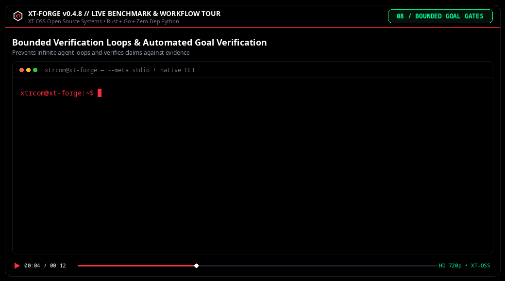

# xt-forge

A fast, harness-agnostic agent toolkit built as a three-tier runtime: a **Rust native CLI** (`native/xtforge-rs/`) for sub-5ms storage, indexing, and binary triage; a **Go concurrency hub** (`native/xtforge-go/`) for stdio MCP gateways, LSP bridges, and container unpacking; and a **zero-dependency Python reference core** (`xtforge/`) with full parity fallback.

**Version:** `0.4.0-Damascus`. The root `VERSION` file is the single source of truth (`name= / version= / codename=`), read by `xtforge/version.py` and `xtforge version`.


## Documentation

Start with the walkthrough guide if this is your first time running `xt-forge`, or jump straight to the deep dive you need:

- **[Getting Started Guide](docs/GUIDE.md)**: installation, `bin/xtforge` routing, everyday commands, `XT_PERM_MODE` (`explore|ask|auto`), and troubleshooting.
- **[Rust + Go Architecture](docs/ARCHITECTURE-RUST-GO.md)**: dispatcher priority (`Rust -> Go Hub -> Python`), zero-dependency binaries, shared SQLite schemas (`mem.db`, `code_graph.db`, `re_overlay.db`), and spill caching.
- **[Reverse Engineering Workbench](docs/RE-WORKBENCH.md)**: stateful `re_overlay.db` annotations, block Shannon entropy, single-byte XOR recovery, native Mach-O headers, Electron ASAR, HAR/SAZ netcaps, APK triage, and confirm-gated dynamic tracing.
- **[MCP Gateway and LLM Steering](docs/MCP-GATEWAY-AND-STEERING.md)**: 4-tool `--meta` gateway vs 56-tool pinned mode, `mcp audit` and SHA-256 rug-pull locking, `mcp proxy`, negative memory (`failed_attempt`), and `goal check` drift detection.
- **[0.4.0 Release Preview Notes](docs/RELEASE-0.4.0.md)**: changelog summary, local preview artifact contents, and verification checklist.

## Key Capabilities in 0.4.0

- **Three-tier execution**: `./bin/xtforge` automatically routes hot verbs to `xtforge-native` (Rust), gateway/network/container verbs to `xtforge-hub` (Go), and everything else to Python stdlib. Force pure Python anytime with `XT_FORCE_PYTHON=1`.
- **Token-lean MCP server (`adapters/mcp/server.py`)**: keeps all `56` pinned tools intact by default, or runs in `--meta` mode exposing just `xt_discover`, `xt_schema`, `xt_call`, and `xt_batch` (`0.90 KB` vs `15.1 KB`, `94.1%` smaller upfront prompt footprint).


- **Security and anti-drift steering**: `mcp audit`, `scan mcp`, and `mcp trust --trust-on-first` detect prompt injections and schema rug-pulls; `guard mode` (`explore|ask|auto`) enforces read-only exploration vs gated writes with JSONL audit logs; `mem record-failure` + `mem consolidate` + `goal check` stop repeated blind alleys.



- **Symbol-aware navigation and RE workbench**: `code index` + `code graph` + `route context --symbols` pull structural callers and callees instead of raw grep noise, while `re` covers ELF/PE/Mach-O, XOR recovery, ASAR, HAR/SAZ, APK, and stateful `re_overlay.db` renames/comments.


## Core Tool Surface

- **cli**: unified dispatcher (`xtforge <group> <verb>`) + slash command passthrough
- **mcp**: stdio MCP server (`56` pinned tools or 4-tool `--meta` gateway), `mcp audit`, `mcp trust`, `mcp proxy`, `mcp status|advice`
- **mem & flash**: sub-50ms `flash` notes + SQLite WAL/FTS5 v3 `mem` store with `record-failure`, `consolidate`, typed links, and `knowledge`
- **code & route**: AST/regex `code_graph.db` (`code index|graph|symbols|outline|refs|lsp`) and symbol-aware `route context --symbols`
- **goal & loop**: bounded autonomous execution with `goal check` drift detection, `<goal-done>` evidence replay (`goal verify`), and `loop schedule|list|stop|status`
- **re & scan**: `re info|sections|symbols|strings|entropy|annotate|asar|netcap|apk|decompile|trace` plus `scan secrets|patterns|deps|mcp|injection`
- **repos, docs, intel, hub, eval, recon**: offline 4,810-repo catalog, library docs, keyless threat intel, HuggingFace metadata, benchmark gates, and reproducible findings ledgers

## Layout

```text
xt-forge/
├── VERSION                  # name=xt-forge / version=0.4.0 / codename=Damascus
├── bin/
│   ├── xtforge              # portable self-locating launcher (Rust -> Go -> Python)
│   └── xtforge-termux       # original Termux reference launcher
├── native/
│   ├── xtforge-rs/          # Rust native CLI (SQLite WAL/FTS5, code_graph, re, scan)
│   └── xtforge-go/          # Go concurrency hub (mcp --meta/proxy/audit, lsp, re, research, loop)
├── xtforge/                 # Zero-dependency Python stdlib implementation (full parity)
├── adapters/
│   ├── mcp/server.py        # 56-tool default MCP server + --meta 4-tool mode
│   └── generic/             # AGENTS.md template for shell-only harnesses
├── plugins/xt-native/       # OpenCode plugin + Node tests
├── catalog/top-repos/       # Offline 4,810-repo catalog
├── docs/                    # Guides, architecture deep dives, and docs/assets/ visuals
└── tests/                   # Contract & integration test suites
```

## Quick Start

```sh
# Check active version, runtimes, and store health
./bin/xtforge version --json
./bin/xtforge doctor --json

# Index call/import symbols and pack symbol-aware context
./bin/xtforge code index .
./bin/xtforge route context . --query "write guard" --symbols

# Record a negative lesson and search with failure warnings
./bin/xtforge mem record-failure --title "Skip TLS verify" --error-sig ERR_TLS --body "Fails pinning check"
./bin/xtforge mem search "TLS" --k 3 --json

# Audit an MCP schema and start the 4-tool meta gateway
./bin/xtforge mcp audit adapters/mcp/server.py
./bin/xtforge mcp serve --meta

# Inspect binaries safely
./bin/xtforge re info /bin/ls --json
./bin/xtforge re entropy /bin/ls --block 4096 --json
./bin/xtforge re strings sample.bin --xor --json
```

## Build & Run Tests

```sh
# Optional: rebuild native tiers (zero external Go/Rust network dependencies)
cd native/xtforge-rs && cargo test && cargo build --release && cd ../..
cd native/xtforge-go && go test -race ./... && go build -ldflags="-s -w" -o xtforge-hub ./cmd/xtforge-hub && cd ../..

# Full Python contract test suite & benchmark probes
python3 -m unittest discover -s tests
python3 test_artifact.py && python3 test_dedup_matrix.py && python3 test_knowledge.py && python3 test_recall.py
python3 scripts/bench_mem_recall.py && python3 scripts/bench_context_pack.py && python3 scripts/bench_secret_scan.py
```

Native dispatch runs automatically when `native/xtforge-rs/target/release/xtforge-native` and `native/xtforge-go/xtforge-hub` exist. Set `XT_FORCE_PYTHON=1` to force pure-Python execution, `XT_NATIVE_HUB=0` to disable only the Go hub, or `XT_PERM_MODE=explore|ask|auto` to lock write safety globally.
