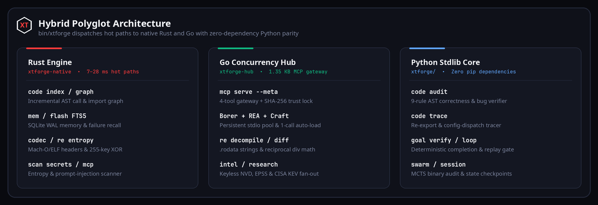

# Rust, Go, and Python Hybrid Architecture

XT-Forge 0.4.0 uses a three-layer architecture designed around one rule: keep every tool functional in zero-dependency Python while letting compiled Rust and Go binaries handle the work each language is best suited for.

## Why Split Rust and Go?

Trying to solve every workload in one runtime creates trade-offs you can feel immediately at the command line:

| Layer | Binary / Package | Strengths Used in XT-Forge | Storage Owned |
| --- | --- | --- | --- |
| Fast Native CLI | `xtforge-native` (`native/xtforge-rs/`) | Sub-10ms SQLite queries, full secret/pattern/injection scanning, codec hashing & entropy, query + `--symbols` packing, Mach-O/XOR scanners, AST/regex code indexing | `mem.db`, `flash/`, `code_graph.db`, `re_overlay.db` |
| Concurrency & Gateway Hub | `xtforge-hub` (`native/xtforge-go/`) | Goroutines + stdio pipes, concurrent keyless threat intel (`nvd`/`epss`/`kev`/`greynoise`/`internetdb`/`circl`), ELF/PE/Mach-O `checksec` & `capa`, JSON-RPC MCP multiplexing, LSP lifecycle, ASAR/ZIP/HAR unpacking | `mcp_trust.json`, `guard_mode.txt`, `loops/schedules.json`, `cache/net/`, `audit/*.jsonl` |
| Reference & Fallback Core | `xtforge/` (`python3 -m xtforge.cli`) | Pure stdlib portability, complex orchestration (`build`, `taste`, `docs`, `hub`, `design`, `artifact`, `knowledge`), offline test harness | Compatible schema mirrors for every store |

All three engines follow the exact same SQLite schemas, JSON envelopes, secret-redaction regexes, and `DENY_GLOBS` path protections. Switching between native mode and `XT_FORCE_PYTHON=1` reads and writes the exact same databases without migration friction.

## Measured Native Speedups

Median elapsed wall time over 5 cold subprocess invocations comparing native Rust/Go execution against `XT_FORCE_PYTHON=1` (pure Python reference):

| Command | Native Runtime | Native (ms) | Python (ms) | Speedup |
| --- | --- | ---: | ---: | ---: |
| `scan secrets xtforge --json` | Rust (`xtforge-native`) | 28.2 | 327.2 | 11.6x |
| `route context xtforge --query route_context --symbols` | Rust (`xtforge-native`) | 15.3 | 162.8 | 10.7x |
| `code index xtforge --json` | Rust (`xtforge-native`) | 6.9 | 122.9 | 17.9x |
| `codec entropy --path native/xtforge-rs/...` | Rust (`xtforge-native`) | 7.7 | 197.5 | 25.8x |
| `re checksec native/xtforge-go/xtforge-hub --json` | Go (`xtforge-hub`) | 8.8 | 120.6 | 13.7x |
| `re capa native/xtforge-go/xtforge-hub --json` | Go (`xtforge-hub`) | 18.3 | 313.9 | 17.2x |
| `intel sources --json` | Go (`xtforge-hub`) | 6.0 | 109.3 | 18.2x |

## Request Dispatch Flow

When you run `xt-forge <noun> <verb> [flags]` (or `xt-forge --meta`):

1. `bin/xtforge` checks `XT_FORCE_PYTHON`. If unset (`0`) and `native/xtforge-rs/target/release/xtforge-native` is executable, it `exec`s directly into Rust (~2ms startup).
2. `native/xtforge-rs/src/main.rs` parses flags and checks `wants_hub(&p)` or top-level `--meta`:
   * `--meta` (`mcp serve --meta`), `mcp proxy`, `mcp audit`, `mcp trust`
   * `intel sources|ip|cve|kev|search|hash|domain`
   * `code lsp`
   * `re checksec|capa|asar|netcap|apk|decompile|trace`
   * `research`
   * `loop schedule|list|stop|status`
   * `guard mode`
   If `XT_NATIVE_HUB` is not `"0"` and `xtforge-hub` is present beside the binary (or at `native/xtforge-go/xtforge-hub`), Rust `exec`s into Go in the caller's original working directory.
3. Otherwise Rust handles `flash`, `route` (including `context --query ... --symbols`), `compress`, `mem`, `code index|graph`, `codec` (`hash|encode|decode|roundtrip|entropy`), `re annotate|entropy|info|strings --xor`, `scan` (`secrets|patterns|injection|mcp`), and `calibrate` directly in compiled native code.
4. Any remaining noun (`build`, `taste`, `docs`, `hub`, `design`, `artifact`, `knowledge`, `plugin`, `scan deps`, or `mcp serve` in default 50-tool mode) cleanly `exec`s `python3 -m xtforge.cli`.

## Shared Data Contracts

### `mem.db` (Schema v3)

Both `native/xtforge-rs/src/mem.rs` and `xtforge/core/mem/store.py` open SQLite in WAL mode and run additive `PRAGMA table_info(mem)` migrations so older v1/v2 databases upgrade safely in place:

* Added `failed_attempt` and `anti_pattern` to `KINDS`
* Added `error_sig` and `outcome` columns on `mem`
* Added `consolidation_log` table tracking threshold, merge count, and summary count
* Consolidated summary notes create typed `derived_from` rows in `links`

### `code_graph.db`

Populated incrementally via SHA-256 file hashes in both `native/xtforge-rs/src/code_graph.rs` and `xtforge/core/code/graph.py`:

* `files (path, lang, sha256, mtime, loc)`
* `symbols (id, file_path, name, fqname, kind, line, signature)`
* `edges (id, src_name, dst_name, rel, file_path, line)`

### `re_overlay.db`

Keyed by target binary SHA-256 in both `native/xtforge-rs/src/re_fast.rs` and `xtforge/core/re/annotate.py`:

* `binaries (sha256, name, format, size, updated)`
* `annotations (id, sha256, rva, kind, orig_name, new_name, type_decl, comment, confidence, updated)`

## Safety Invariants Across Runtimes

Both Go's `internal/guard` and Rust's `src/guard.rs` mirror Python's `xtforge/core/route/guard.py`:

* Canonical realpath verification against `DEFAULT_ROOTS` (including `.dsh` account-scoped homes automatically)
* Hard deny globs for SSH keys, `.env` secrets, keystores, and credentials
* Confirm-token issuance for write mutations or live process tracers (`re trace`)
* Automatic output compression and artifact spilling (`cache/artifacts/spill_*.json`) whenever a proxy or gateway payload exceeds threshold bytes
