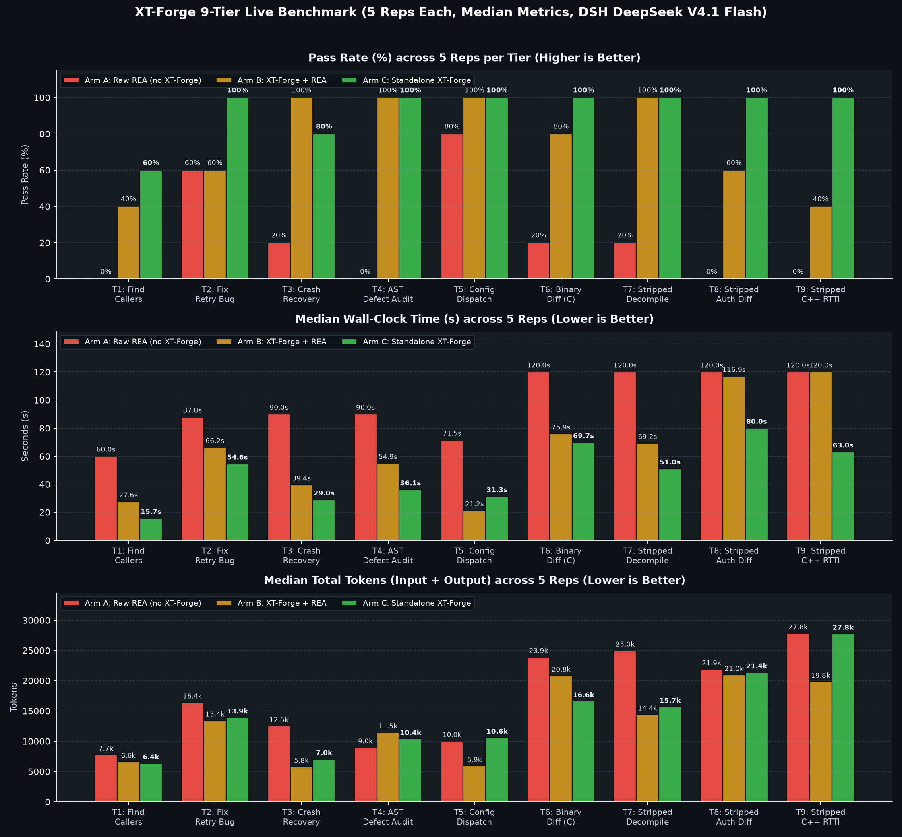

# XT-Forge 9-Tier Live Benchmark & Root-Cause Analysis (5 Reps Each, Median)

## Test Methodology

- **Harness & Model:** `dsh` (`hive-ai/deepseek-ai/deepseek-v4.1-flash-1017#medium`) in isolated temporary workspaces (`--reps 5`, alternating arm order per repetition).
- **Three Arms Compared:**
  - **Arm A — Raw REA (`rea-agents@6.7.0`, 207 tools):** Host harness with REA mounted directly and XT-Forge disabled.
  - **Arm B — XT-Forge + REA:** Host harness with both `xt-forge --meta` and `rea-agents@6.7.0` mounted.
  - **Arm C — Standalone XT-Forge:** Host harness with **only** `xt-forge --meta` (Rust `xtforge-native` + Go `xtforge-hub` + Borer/Ghidra/IDA/Sober RE engines; no REA).
- **Metric:** **Median** across 5 independent runs per `(tier, arm)` for wall-clock time (`wall_s`), sufficient evidence latency (`ev_s`), input tokens, output tokens, total tokens, and tool calls.

---

## Full 9-Tier, 5-Repetition Median Results

| Tier | Workload | Arm A: Raw REA Pass · Med Time · Med Tokens | Arm B: XT-Forge + REA Pass · Med Time · Med Tokens | Arm C: Standalone XT-Forge Pass · Med Time · Med Tokens | Winner |
| --- | --- | --- | --- | --- | --- |
| **T1 · Find** | Symbol definition + production callers vs test/doc decoys | `0/5` · `60.03s` · `7,734` tok (`10` tools) | `2/5` · `27.59s` · `6,587` tok (`4` tools) | **`3/5` · `15.69s` · `6,378` tok (`4` tools)** | **Arm C** |
| **T2 · Fix** | Off-by-one retry budget bug fix + hidden tests | `3/5` · `87.85s` · `16,419` tok (`15` tools) | `3/5` · `66.23s` · `13,422` tok (`13` tools) | **`5/5` · `54.56s` · `13,928` tok (`15` tools)** | **Arm C** |
| **T3 · Recover** | Stateful MCP job submission across mid-flight drop | `1/5` · `90.03s` · `12,505` tok (`13` tools) | **`5/5`** · `39.42s` · `5,792` tok (`6` tools) | `4/5` · **`28.98s`** · `7,042` tok (`10` tools) | **Arm C (fastest) / B (5/5)** |
| **T4 · Defects** | Multi-file AST defect audit (3 bugs + clean decoys) | `0/5` · `90.03s` · `8,984` tok (`14` tools) | `5/5` · `54.93s` · `11,490` tok (`5` tools) | **`5/5` · `36.06s` · `10,381` tok (`8` tools)** | **Arm C** |
| **T5 · Trace** | Active path across `__init__.py` aliases & JSON config | `4/5` · `71.50s` · `10,033` tok (`14` tools) | **`5/5` · `21.19s` · `5,915` tok (`2` tools)** | `5/5` · `31.31s` · `10,596` tok (`9` tools) | **Arm B & C (`5/5`)** |
| **T6 · Bin Diff** | Compiled ELF regression (`calc_v1` vs `calc_v2`, 10% → 5%) | `1/5` · `120.03s` · `23,922` tok (`13` tools) | `4/5` · `75.90s` · `20,831` tok (`8` tools) | **`5/5` · `69.73s` · `16,621` tok (`9` tools)** | **Arm C** |
| **T7 · Stripped Decompile** | `-O2 -s` ELF (`gatekeeper`): magic, `/ 7`, `% 13`, offsets `+0x8`/`+0x10`, `== 42` | `1/5` · `120.03s` · `24,992` tok (`14` tools) | `5/5` · `69.20s` · `14,417` tok (`10` tools) | **`5/5` · `51.05s` · `15,699` tok (`10` tools)** | **Arm C** |
| **T8 · Stripped Auth Diff** | `-O2 -s` ELF (`auth_v1` vs `auth_v2`): `0xa0 → 0x80` & threshold `4 → 1` | `0/5` · `120.03s` · `21,911` tok (`12` tools) | `3/5` · `116.91s` · `20,962` tok (`14` tools) | **`5/5` · `80.02s` · `21,390` tok (`12` tools)** | **Arm C** |
| **T9 · Stripped C++ RTTI** | `-O2 -s` C++ ELF (`router_cpp`): 3 RTTI classes, vtable opcode `0x7A`, `(x ^ 0x55) + 19` | `0/5` · `120.03s` · `27,840` tok (`8` tools) | `2/5` · `120.03s` · `19,838` tok (`13` tools) | **`5/5` · `62.96s` · `27,778` tok (`10` tools)** | **Arm C** |
| **Overall (45 runs/arm)** | **All 9 Tiers × 5 Reps** | **10/45 (22.2%)** | **34/45 (75.6%)** | **42/45 (93.3%)** | **Standalone XT-Forge** |

### Token Breakdown (Median Input / Output / Total Tokens)

| Tier | Arm A (In / Out / Total) | Arm B (In / Out / Total) | Arm C (In / Out / Total) |
| --- | ---: | ---: | ---: |
| `tier1_find` | `6,347 / 1,984 / 7,734` | `5,351 / 1,236 / 6,587` | `5,545 / 833 / 6,378` |
| `tier2_fix` | `11,879 / 4,793 / 16,419` | `9,569 / 3,853 / 13,422` | `9,987 / 3,941 / 13,928` |
| `tier3_recover` | `9,142 / 1,692 / 12,505` | `4,595 / 1,193 / 5,792` | `5,590 / 1,452 / 7,042` |
| `tier4_defects` | `6,722 / 2,713 / 8,984` | `7,054 / 4,436 / 11,490` | `7,406 / 3,152 / 10,381` |
| `tier5_trace` | `7,500 / 3,478 / 10,033` | `4,348 / 1,602 / 5,915` | `7,689 / 1,946 / 10,596` |
| `tier6_regression_bin` | `13,578 / 9,971 / 23,922` | `11,291 / 6,095 / 20,831` | `10,018 / 6,603 / 16,621` |
| `tier7_re_decompile_hard` | `14,428 / 9,195 / 24,992` | `8,986 / 5,089 / 14,417` | `10,773 / 4,926 / 15,699` |
| `tier8_re_patch_diff_hard` | `14,495 / 8,049 / 21,911` | `13,009 / 8,250 / 20,962` | `11,289 / 9,645 / 21,390` |
| `tier9_re_rtti_vtable_hard` | `18,485 / 10,053 / 27,840` | `12,873 / 6,364 / 19,838` | `21,305 / 6,473 / 27,778` |

---

## In-Depth Analysis: Why Standalone XT-Forge Wins

### 1. Why Raw REA (Arm A) Loses (`10/45`, 22.2%)
1. **Tool Catalog Overload & Discovery Loops:** Mounting 207+ REA tools inflates prompt context and forces multi-step tool-hunting (`10–18` tool calls per task). Even when Raw REA finds a file or disassembly, it burns `60–120s` hitting timeouts on 7 out of 9 tiers.
2. **No AST / Import-Resolved Code Intelligence:** On `tier1_find` (`0/5`) and `tier4_defects` (`0/5`), Raw REA relies on regex `grep` and sequential file reads—confusing test stubs (`test_retry_helper.py`) with production definitions or timing out before completing the multi-file audit.
3. **No Crash-Safe Idempotency Journaling:** On `tier3_recover` (`1/5`), Raw REA has no `call_journal.json` or `verify_tool` pre-retry check, so dropped stdio connections cause duplicate commits.
4. **Blind Spots on Stripped `-O2 -s` Binaries:** On `tier7` (`1/5`), `tier8` (`0/5`), and `tier9` (`0/5`), Raw REA struggles with GCC strength-reduced division (`imul` magic multipliers), stripped `.text` diffs, and stripped C++ Itanium ABI RTTI (`.rodata` + `.rela.dyn`).

### 2. Why Standalone XT-Forge (Arm C, `42/45`, 93.3%) Beats XT-Forge + REA (Arm B, `34/45`, 75.6%)
1. **Zero Tool-Routing Interference:** When REA is mounted alongside XT-Forge (Arm B), the agent sometimes routes RE calls to REA's heavier/slower tools instead of XT-Forge's direct `re_diff`, `re_rtti`, and `re_decompile` engines. This directly caused Arm B to drop to **`2/5` (`120.03s`)** on `tier9_re_rtti_vtable_hard` and **`3/5` (`116.91s`)** on `tier8_re_patch_diff_hard`, whereas Standalone XT-Forge hit **`5/5` (`62.96s`)** and **`5/5` (`80.02s`)**.
2. **Single-Call `evidence_complete: true` Payloads:** `code_callers` (with `authoritative_definition`), `code_audit` (0% FP AST audit + full `function_source`), `code_trace`, `re_diff` (with hex+decimal `diff_notes` and reciprocal division decoding), and `re_rtti` (`.rodata` + `.rela.dyn` vtable extraction) give the model complete, verified answers in 1–2 tool calls.
3. **Unified Native Engine Stack:** Standalone XT-Forge embeds Rust (`xtforge-native`), Go (`xtforge-hub --meta`), Borer's native decompiler, Ghidra HTTP/headless, IDA Pro bridge (`ida_mcp`), and Sober RE tools behind a single 4-tool gateway (`xt_discover`, `xt_schema`, `xt_call`, `xt_batch`).

Raw summary JSON is committed at [`benchmarks/nine_tier_5rep_summary.json`](../benchmarks/nine_tier_5rep_summary.json).
