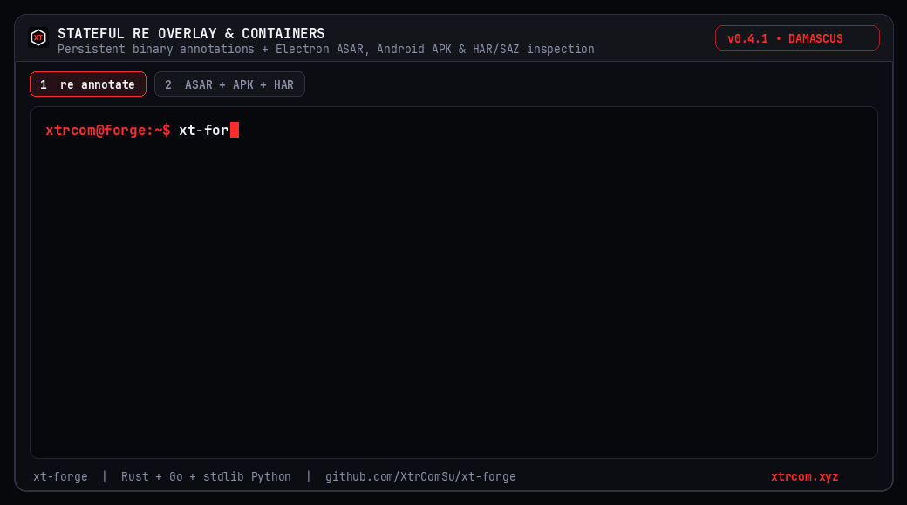

# CVE Research and Reverse Engineering Deep Dive

Most agent toolkits treat binaries and vulnerability research as afterthoughts. Either they give an LLM raw shell commands (`strings`, `objdump`) that flood the context window with 50 KB of hex noise, or they mount a 200-tool MCP server that burns 8,000 tokens before your first question.

`xt-forge` ships a dedicated, zero-dependency **CVE intelligence (`intel`)** and **reverse engineering (`re`)** stack designed to run offline or keyless by default, return compact structured JSON, and preserve your analysis notes across sessions.

Watch the full end-to-end walkthrough: [cve-re-workflow.mp4](videos/cve-re-workflow.mp4)



---

## 1. Keyless CVE and Threat Intelligence (`xtforge intel`)

Every default source inside `xtforge intel` requires **zero API keys** and **zero signups**. Each upstream source fails independently, so an outage on one feed only omits that field instead of breaking your triage run. Responses cache cleanly in `$XT_HOME/cache/` with source-specific TTLs.

| Command | Sources Queried | What You Get |
| --- | --- | --- |
| `./bin/xtforge intel cve CVE-2024-3094` | NVD 2.0 + FIRST EPSS + CISA KEV | CVSS severity, description, live exploit probability percentile (EPSS), and whether it is actively exploited (KEV) |
| `./bin/xtforge intel kev --query openssh` | CISA Known Exploited Catalog | Filtered list of actively exploited vulnerabilities, deadlines, and ransomware associations |
| `./bin/xtforge intel search <kw> --since 30` | NVD 2.0 keyword search | Recent CVEs matching a library, product, or component within the last `N` days |
| `./bin/xtforge intel ip 203.0.113.10` | Shodan InternetDB + GreyNoise Community | Open ports, hostnames, CPEs, known CVEs, and benign-scanner vs noisy/malicious classification |
| `./bin/xtforge intel domain example.com` | System DNS | A, AAAA, MX, NS, TXT, and CNAME records plus SPF/DMARC checks |
| `./bin/xtforge intel hash <md5\|sha1\|sha256>` | CIRCL hashlookup (+ VT / MalwareBazaar if keys set) | Known-good OS/package match vs unknown/malicious sample lookup |

Optional API keys (`XT_VT_KEY` for VirusTotal, `XT_ABUSECH_KEY` for MalwareBazaar) join automatically when present without altering any command signature.

### Pairing IOC Extraction with Intel

Instead of copying suspicious strings by hand:

```sh
# 1. Pull URLs, IPs, hashes, file paths, and CVE IDs out of a binary (credentials masked by default)
./bin/xtforge re ioc suspicious.bin --json

# 2. Enrich any extracted CVE ID or public IP without leaving your terminal
./bin/xtforge intel cve CVE-2024-3094 --json
./bin/xtforge intel ip 198.51.100.42 --json
```

---

## 2. Offline Binary Inspection (`xtforge re`)

All static binary inspection runs locally in Rust (`xtforge-native`), Go (`xtforge-hub`), or pure stdlib Python. Samples are opened read-only and never executed unless you explicitly invoke `re trace` with a `write_guard` confirm token.

### A. First-Pass Triage: Format, Mitigations, and Packing

```sh
./bin/xtforge re info sample.bin --json         # ELF, PE/COFF, or Mach-O 32/64 headers + entry point
./bin/xtforge re checksec sample.elf --json     # RELRO, stack canary, NX, PIE, RPATH/RUNPATH
./bin/xtforge re sections sample.bin --json     # Section sizes, permissions, and offsets
./bin/xtforge re entropy sample.bin --block 4096 --json  # Shannon entropy per block (detects packing/crypto)
./bin/xtforge re pack sample.bin --json         # UPX, PyInstaller, ASAR, NSIS, Inno signatures
```

**Why block entropy matters**: A healthy `.text` section usually measures around `5.8` to `6.6` bits per byte. Encrypted payloads, compressed stubs, or XOR tables spike above `7.2`, showing you the exact offset range worth inspecting first.

### B. Automated Capability and Indicator Recovery

- **CAPA capability rules (`re capa`)**: maps imports and opcode patterns to tactical behaviors (`anti-debug`, `process-injection`, `crypto`, `network-beacon`, `persistence`) with zero external rules download required.
- **C++ RTTI and vtable recovery (`re rtti`)**: reconstructs C++ class hierarchies and virtual tables from `.rodata` / `.rdata` typeinfo structures.
- **API hooks and syscalls (`re hooks`)**: highlights inline trampolines, suspicious import resolvers, and direct syscall stubs.
- **Crash and panic triage (`re crash`)**: parses crash reports and tracebacks to isolate faulting frames and register state.

### C. Deobfuscation: Stack Strings and XOR Brute-Forcing

Malware and obfuscated installers rarely leave clear ASCII strings around. `xtforge` handles both common encoding tricks directly in compiled Rust/Python:

```sh
# Recover single-byte XOR-obfuscated URLs, paths, and user-agents across all 255 keys
./bin/xtforge re strings sample.bin --xor --min-len 8 --json

# Reconstruct strings pushed byte-by-byte onto the stack inside disassembled functions
./bin/xtforge re strings sample.bin --stack --json
```

### D. Control-Flow Graphs, Cross-References, Diffing, and HTML Viewers

```sh
./bin/xtforge re disasm sample.bin --symbol main --count 60 --json
./bin/xtforge re cfg sample.bin --rva 0x1000 --json
./bin/xtforge re xrefs sample.bin --target decrypt_config --json
./bin/xtforge re diff build_v1.bin build_v2.bin --json   # Security patch diffing
./bin/xtforge re view sample.bin --out report.html      # Self-contained offline HTML CFG viewer
```

### E. Container, Mobile, and Network Capture Extraction

Real-world reverse engineering extends well beyond raw ELF/PE binaries:

```sh
# Electron apps: parse ASAR headers, unpack entries cleanly, flag .js.map files
./bin/xtforge re asar resources/app.asar --grep main --json

# Network captures: summarize HAR/SAZ requests with Authorization/Cookie/tokens masked
./bin/xtforge re netcap session.har --json
./bin/xtforge re netcap session.har --reveal --json      # Only when explicit review is needed

# Android APKs: list DEX files, native .so ABIs, signing certs, and manifest metadata
./bin/xtforge re apk target.apk --json

# Best-effort native decompile wrapper (prefers local rizin/ghidra/objdump, falls back to builtin disasm)
./bin/xtforge re decompile sample.bin --rva 0x1000 --json
```

---

## 3. Stateful Reverse Engineering Overlays (`re_overlay.db`)

Whenever you rename an address, add an analyst note, or declare a C signature during triage, `xt-forge` saves it in `$XT_HOME/re_overlay.db` keyed by the **binary's SHA-256 hash**. That solves two major problems:

1. **The target binary is never altered.**
2. **Annotations automatically enrich later output** (`re cfg`, `re xrefs`, and future agent sessions immediately display `xor_decode` instead of `sub_401820`), and can be exported into native scripts for full GUI tools:

```sh
./bin/xtforge re annotate rename sample.bin 0x401820 xor_decode --orig sub_401820 --confidence 0.95
./bin/xtforge re annotate comment sample.bin 0x401820 "0x5a single-byte key C2 beacon decoder"
./bin/xtforge re annotate type sample.bin 0x401820 --type-decl "int xor_decode(uint8_t *buf, size_t len)"
./bin/xtforge re annotate list sample.bin --json

# Export directly for Radare2/Rizin or Ghidra
./bin/xtforge re annotate export sample.bin --format r2 > load_names.r2
./bin/xtforge re annotate export sample.bin --format ghidra > ApplyNames.py
```

---

## 4. Guarded Patching and Confirm-Gated Tracing

When analysis crosses into binary modification or live tracing:

- **Byte patching (`re patch`)** verifies `--orig-bytes` before editing and operates safely inside your workspace allowlist (`./bin/xtforge re patch app.bin --offset 0x1240 --orig-bytes 7405 --patch-bytes 9090 --out app.patched.bin`).
- **Dynamic tracing (`re trace`)** refuses execution unless both `XT_PERM_MODE` permits mutation and an explicit single-use `--confirm <token>` issued by `xtforge guard token` is supplied.

Everything recorded along the way can also be filed into a reproducible findings report via `xtforge recon new <target>`, `recon finding`, and `recon report`.
