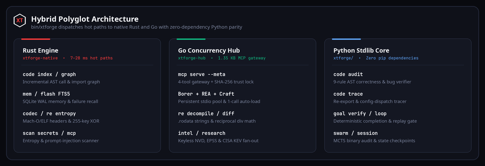

# XT-Forge Field Guide

Welcome to **XT-Forge 0.4.0**. If you use coding agents, reverse engineering utilities, or local CLI automations every day, you already know where things usually break down: your tool catalog silently eats half the context window before you even ask a question, the agent keeps trying the same broken fix four times in a row, or a 900 line trace log gets dumped straight into your prompt.

XT-Forge solves those friction points with one local, zero-dependency toolkit. It ships a pure Python reference core alongside native **Rust** and **Go** engines, so quick lookups finish in milliseconds while heavy MCP proxying, LSP calls, and archive unpacking run concurrently without blocking your shell.



For a full guided walkthrough covering installation, the `--meta` gateway, call graphs, and verification loops, see [xtforge-overview.mp4](videos/xtforge-overview.mp4).

## 1. Quick Start and Layout

Install `xt-forge` globally and sync the `XTF-*` workflow skills via `npx xt-forge init` (or `./install.sh`). Everything stays self-contained inside your workspace and `$XT_HOME` (defaulting to `~/.xt-forge`):

```sh
xt-forge version
xt-forge doctor
xt-forge calibrate
```

By default, `xt-forge` dispatches hot paths to `xtforge-native` (Rust), concurrent gateway and runtime commands to `xtforge-hub` (Go), and higher-level workflows to Python. Set `XT_FORCE_PYTHON=1` at any time if you want to test or run purely through Python, or `XT_NATIVE_HUB=0` to bypass the Go binary.

## 2. Permission Modes and Audit Logs

Before letting an agent edit files or spawn external programs, pick the posture that fits the session:

* **`explore` (read-only lock):** Blocks write mutations, state changes outside safe read paths, and live tracers. Ideal when auditing unfamiliar repositories or malware samples.
* **`ask` (balanced default):** Permits normal reads and scoped writes while gating destructive or runtime-invasive operations behind single-use confirm tokens.
* **`auto` (trusted workspace):** Allows write helpers within allowlisted roots while still logging every action to disk.

Check or change your mode at any time:

```sh
xt-forge guard mode
xt-forge guard mode explore
xt-forge guard mode ask
```

Every guard decision, mode transition, and MCP gateway call appends a compact JSON record to `~/.xt-forge/audit/YYYY-MM-DD.jsonl`. Nothing happens silently behind your back.

## 3. Code Navigation That Respects Token Budgets

Running `grep` over a medium codebase pulls in noisy matches from tests, comments, and unrelated modules. XT-Forge lets you build a lightweight multi-language symbol and call graph first, then expand `route context` along real caller/callee relationships:

```sh
# Index workspace definitions and call edges into code_graph.db
xt-forge code index .

# Walk callers and callees for any symbol
xt-forge code graph verify_sig . --depth 2 --json

# Pull budget-packed source windows boosted by symbol graph edges
xt-forge route context . --query "verify_sig" --symbols --token-budget 1200

# Ask an on-demand language server (pyright, rust-analyzer, gopls, clangd, tsserver)
xt-forge code lsp def xtforge/core/route/pack.py --line 194 --col 10 --json
```

If an external language server is not installed on your host, `code lsp` falls back cleanly to your local `code_graph.db` index so scripts never break.

## 4. Memory That Learns From Mistakes

Standard vector or full-text notes store facts, yet they rarely warn an agent away from dead ends it hit yesterday. XT-Forge 0.4.0 introduces negative constraints (`failed_attempt` and `anti_pattern`) paired with periodic consolidation:

```sh
# Record a broken approach with its exact error signature
xt-forge mem record-failure \
  --title "Skip TLS verification behind proxy" \
  --body "Passing insecure bypass flags breaks corporate MITM pinning checks" \
  --error-sig "ERR_TLS_PIN"

# Normal search surfaces matching warnings automatically in output JSON
xt-forge mem search "corporate MITM pinning" --json

# Preview merging repetitive notes (Jaccard similarity clustering)
xt-forge mem consolidate --dry-run --threshold 0.55

# Write consolidated summary records with full derived_from provenance links
xt-forge mem consolidate --threshold 0.55
```

Every merge records provenance edges in the `links` table (`derived_from`) and writes an audit row to `consolidation_log`, leaving source history intact and inspectable.

## 5. Keeping Long Goal Runs on Track (`goal check`)

Autonomous loops often drift sideways or balloon a two-file fix into twenty modified files. Run a fast metacognitive sanity check before committing to the next step:

```sh
xt-forge goal check "Refactor WAL checkpoint locking" \
  --criteria "checkpoint durability verified; no blocked writers" \
  --workdir .
```

The checker cross-references your git status diff count, criteria terms missing from your active plan or changed files, repeated identical errors across goal rounds, and relevant `failed_attempt` notes stored in `mem.db`.

## 6. Research Dossiers and Durable Schedules

When you need a single starting packet on an unfamiliar bug, symbol, or CVE, fan out concurrently across memory, code evidence, and local indexes with one command:

```sh
xt-forge research "SCHEMA_VERSION" --path . --k 5 --save
```

When you need lightweight recurring checks without keeping an interactive loop open in your chat session:

```sh
xt-forge loop schedule 5m --cmd "xtforge doctor --json"
xt-forge loop list
xt-forge loop stop <task-id>
```

Scheduled tasks enforce a hard cap of 50 entries and a 7-day lifetime, plus the `XT_NATIVE_LOOP=0` kill switch.

## Next Stops

* Architecture breakdown: [Architecture (Rust + Go + Python)](ARCHITECTURE-RUST-GO.md)
* Binary and container analysis: [Reverse Engineering Workbench](RE-WORKBENCH.md)
* Context savings and security: [MCP Meta-Gateway and Steering](MCP-GATEWAY-AND-STEERING.md)
