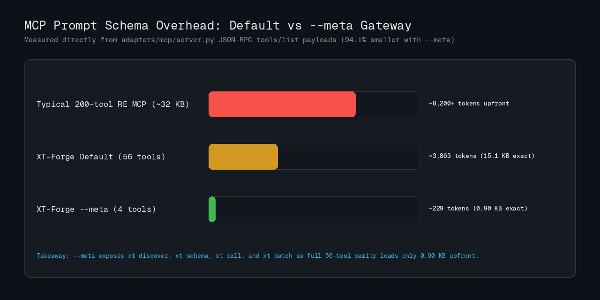
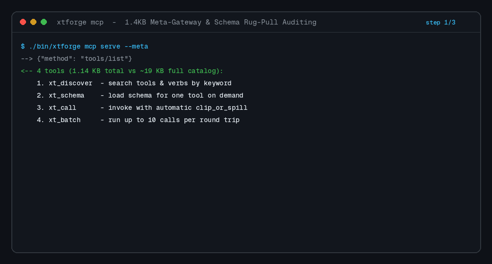
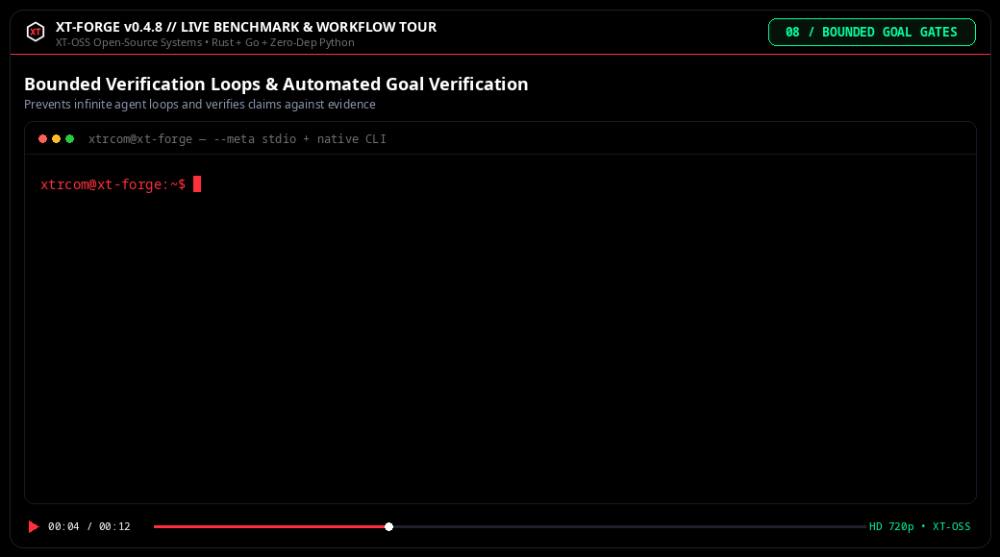
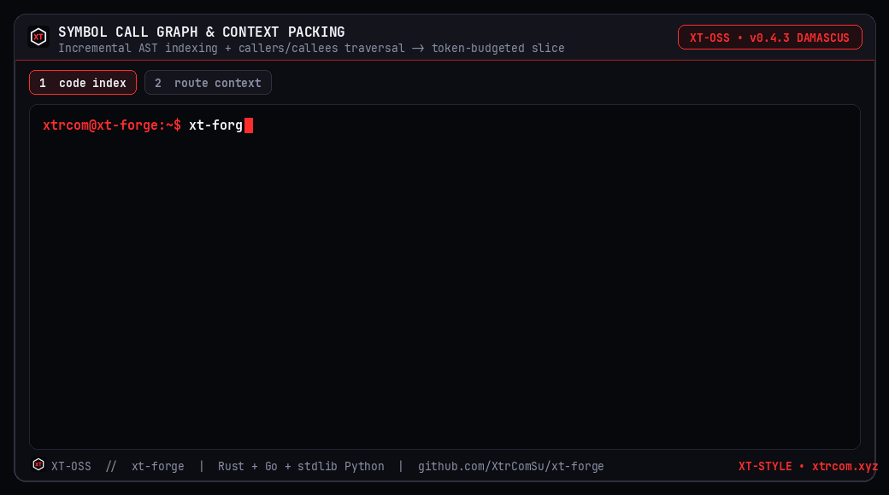

# MCP Meta-Gateway, Supply-Chain Auditing, and Agent Steering

Mounting four or five traditional MCP servers can silently burn 30,000+ prompt tokens on JSON schemas before the user ever types a message. Worse, third-party MCP servers can swap tool descriptions after installation ("schema rug pulls") or sneak hidden prompt-injection instructions into docstrings.

XT-Forge 0.4.0 tackles both token overhead and supply-chain risk in one layer.



## 1. Keeping Compatibility AND Cutting Schema Overhead (`--meta`)

Default `adapters/mcp/server.py` keeps its exact pinned catalog (`56` tools) so existing clients and contracts stay unchanged. Whenever your harness wants lean gateway discovery, add `--meta`:

```sh
./bin/xtforge mcp serve --meta
# or in pure Python mode:
python3 -m adapters.mcp.server --meta
```

In `--meta` mode, `tools/list` exposes only **4 compact meta-tools** (~1.4 KB total schema weight):

1. `xt_discover`: Keyword search across all 56+ tools and CLI subcommands.
2. `xt_schema`: On-demand JSON schema lookup for a single tool you actually plan to invoke.
3. `xt_call`: Dispatch any XT-Forge MCP tool or CLI noun/verb.
4. `xt_batch`: Run up to 10 read or analysis calls in a single JSON-RPC round trip.

Every `xt_call` and `xt_batch` payload automatically runs through `clip_or_spill`: concise responses return inline, while oversized payloads spill to `~/.xt-forge/cache/artifacts/` with an `L1` compressed preview so one large call never crashes a context window.



## 2. Prompt-Injection Scan and Rug-Pull Pinning

Before trusting a third-party MCP stdio server, inspect its `tools/list` payload and pin its cryptographic SHA-256 baseline:

```sh
# Offline scan of a saved MCP manifest JSON file (native Rust scanner)
./bin/xtforge scan mcp ./suspicious_tools.json --json

# Live handshake audit with trust-on-first pinning
./bin/xtforge mcp audit --server fs-helper --cmd "npx -y @org/mcp-fs" --trust-on-first --json

# Explicit pin / inspect trust DB (~/.xt-forge/mcp_trust.json)
./bin/xtforge mcp trust --server fs-helper --cmd "npx -y @org/mcp-fs" --json
./bin/xtforge mcp trust --json
```

On subsequent launches, if any tool docstring injects hidden tags (`<system>`, `[SYSTEM]`, `ignore previous instructions`, `.ssh/id_rsa`, `curl | sh`, stealth instructions, or zero-width characters) OR changes a pinned schema hash silently, `mcp audit` exits non-zero and reports `"rug_pull": true` (`status: "rug_pull"`).

You can also wrap an upstream MCP server in Go's compression/audit proxy:

```sh
./bin/xtforge mcp proxy --prefix fs --cmd "npx -y @org/mcp-fs" --trust-on-first
```

## 3. Agent Steering Workflows



### Metacognitive Checkpoints (`goal check`)

Run `xtforge goal check` before high-impact edits or mid-way through a multi-round goal:

```sh
./bin/xtforge goal check "Migrate storage index" \
  --criteria "WAL mode preserved; all unit tests pass" \
  --workdir . --json
```

* Flags **scope bloat** when touched files exceed `file_cap`.
* Flags **criteria drift** when current changes and plan omit required acceptance keywords.
* Flags **repeat errors** if consecutive rounds emit identical failure traces.
* Injects **negative memory** warnings from `mem.db` (`failed_attempt` and `anti_pattern`).

### Negative Memory (`mem record-failure`) and Consolidation (`mem consolidate`)

```sh
# Teach the toolkit what failed and why
./bin/xtforge mem record-failure \
  --title "Avoid unindexed LIKE scan on large table" \
  --body "Full table scan exceeded 4s timeout during peak ingestion" \
  --error-sig "SQLITE_TIMEOUT"

# Consolidate repetitive notes while keeping full derived_from provenance links
./bin/xtforge mem consolidate --dry-run
./bin/xtforge mem consolidate
```



### Graph-Aware Context Packing (`route context --symbols`)

Pairing `code index` with `route context --symbols` solves the classic problem where text search finds a function signature but misses the callers and callees needed to fix a bug safely.
