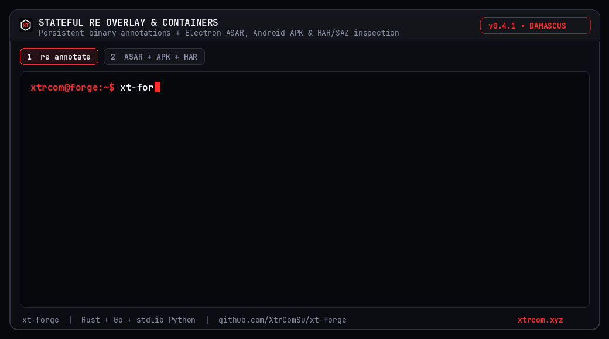

# Reverse Engineering Workbench (`re`)

Reversing software cleanly with an agent usually hits two walls: massive decompiler outputs flood the prompt, and every time the binary gets re-analyzed in a new chat, the analyst's symbol renames and comments vanish.

XT-Forge 0.4.0 keeps everything deterministic, content-addressed, and gentle on context tokens.



## Start an RE repository

Create a starter in a new directory with `xtforge re init-project`.

```sh
xtforge re init-project ./image-research --name "Image research"
cd image-research
git init
```

The starter includes a README with an XT-Forge-SYS walkthrough GIF, a redistributable C fixture, a findings report, and GitHub issue and pull request templates. Build the fixture using the generated README, then replace the example finding and GIF with your project's evidence.

After creating the first commit, run `python scripts/update_activity.py` and commit `docs/assets/activity.svg`. The script reads the current Git history locally and charts 52 weeks of daily commits using UTC author dates. It requires Git and Python 3.11 or newer. Use a full clone to include commits that a shallow clone might omit.

Use `--json` if you need the generated file list for a script. The destination's parent must exist and the destination must be new.

## 1. Stateful Annotation Overlays (`re annotate`)

Instead of mutating original executables on disk or locking notes inside a proprietary database format, `re annotate` hashes the binary (`sha256`) and stores renames, inline comments, and C type declarations inside `$XT_HOME/re_overlay.db`.

```sh
# Rename an unnamed subroutine at RVA 0x1200
xt-forge re annotate rename ./sample.bin --rva 0x1200 --orig sub_1200 --name decrypt_cfg

# Attach an analyst note and C signature
xt-forge re annotate comment ./sample.bin --rva 0x1200 --comment "RC4 key schedule loop"
xt-forge re annotate type ./sample.bin --rva 0x1200 --type-decl "int decrypt_cfg(uint8_t *buf, size_t len)"

# List saved overlays for this binary
xt-forge re annotate list ./sample.bin --json

# Export portable scripts for external disassemblers
xt-forge re annotate export ./sample.bin --format r2
xt-forge re annotate export ./sample.bin --format ghidra
```

Whenever you run `xtforge re cfg` or `xtforge re xrefs` against the same binary, XT-Forge checks `re_overlay.db` and merges your saved renames and comments directly into the output blocks and call references.

## 2. Fast Byte-Level Triage in Rust

For packed samples, malware triage, or Mach-O/ELF/PE executables, heavy parsing runs directly in native Rust:

* **Per-block Shannon entropy:** Spot encrypted sections (`>= 7.2` bits/byte) before opening a disassembler:
  ```sh
  xt-forge re entropy ./sample.bin --block 4096 --count 32 --json
  ```
* **Single-byte XOR string recovery:** Scans all 255 non-zero keys and sorts candidate decoded strings by length so real URLs and C2 tokens rise above short false positives:
  ```sh
  xt-forge re strings ./sample.bin --xor --min-len 6 --json
  ```
* **Mach-O header parsing:** Identifies 32/64-bit endianness, CPU architecture (`x86_64`, `arm64`), and load command count natively in Rust alongside existing ELF and PE parsers:
  ```sh
  xt-forge re info ./macos_tool --json
  ```

## 3. Electron `.asar`, Network Captures, and Android `.apk`

Real reverse engineering engagements rarely consist of a single stripped C binary. Go's `xtforge-hub` (with pure-Python stdlib parity) unpacks modern application containers directly:

### Electron ASAR Archives

```sh
xt-forge re asar ./app.asar --limit 100 --json
```

Reads Chromium's Pickle header cleanly, flags embedded source maps, and lists bundled files without running `npm` or Electron.

### HAR and Fiddler SAZ Network Captures

```sh
xt-forge re netcap ./session.har --limit 50 --json
```

Summarizes HTTP methods, status codes, and API endpoints while **masking sensitive headers (`Authorization`, `Cookie`, `Set-Cookie`, `X-API-Key`) by default**. Pass `--reveal` only when you explicitly need unmasked values.

### Android APKs

```sh
xt-forge re apk ./target.apk --json
```

Extracts `classes*.dex` inventories, native `lib/<abi>/*.so` libraries, and declared `android.permission.*` strings from the package without needing a heavy JVM startup. If `jadx` or `apktool` is present, you get full decompilation compatibility too.

## 4. Headless Decompilation and Confirm-Gated Tracing

When you have `rizin`, `r2`, or `objdump` available locally:

```sh
xt-forge re decompile ./sample.bin --symbol decrypt_cfg
```

Dynamic instrumentation (`frida-trace` or `gdb`) stays locked by default and requires both an active permission mode outside `explore` and a single-use confirm token:

```sh
xt-forge re trace ./sample.bin --preset api_trace --dry-run
```

## 5. Format and capability matrix

The native SYS engine (`xtforge-hub`, package `internal/sysimage`) detects a container first, then the payload's own format. "Fixture-verified" below means the path was exercised by a purpose-built fixture in `scripts/verify_sys_native.py` or a Go unit test; it does **not** mean the capability was checked on a real-world sample of that format.

| Capability | Linux ELF | Windows PE | macOS/iOS Mach-O | Status |
| --- | --- | --- | --- | --- |
| Direct image parse (`re overview`, `re info`) | `elf` (`debug/elf`), 32/64-bit | `pe` (`debug/pe`), PE32/PE32+ | `macho` thin (32/64-bit, both byte orders) and universal/fat with per-slice offsets | `overview.go`; fixture-verified on compiled C fixtures, not on real-world samples |
| CPUs named by the overview | x86, x86-64, arm, arm64 | x86, x86-64, arm, arm64 | x86, x86-64, arm, arm64 | `overview.go` (`archName`, `peImage`); only x86-64 and arm64 exercised by fixtures |
| PE arm64ec / arm64x machine names | n/a | named by `DescribePEMachine` / `PECallingConvention` only | n/a | `pemachine.go` + unit tests; not wired into overview or decoding, no sample exercised |
| Native decode and lift to C | x86-64 only | x86-64, arm64 | x86-64, arm64 | `disasm.go`, `structured.go`; fixture-verified; little-endian only — 32-bit x86/arm and big-endian images are refused by the native decoder |
| Function naming from symbol tables | `.symtab` + `.dynsym` (`elf_symtab`, `elf_dynsym`) | COFF symbols (`pe_coff_symbol`) + export directory (`pe_export`) | `nlist` code symbols (`macho_code_symbol`) + `LC_FUNCTION_STARTS` (`macho_function_starts`) | `functions.go`, `pe_exports.go`; fixture-verified on compiled fixtures |
| DWARF `DW_TAG_subprogram` names | supported | supported | supported | `dwarf.go`; names only addresses already in the function index. Hand-built rows in a Go unit test only — not exercised by `verify_sys_native.py` or real samples |
| Objective-C metadata naming | n/a | n/a | class, method and category metadata | `objc.go`, `objccat.go`; fixture-verified on synthetic Mach-O bytes; real-sample check opt-in via `XTF_REAL_MACHO` |
| Swift symbol demangling | n/a | n/a | `_$s` / `$s` mangled names via `DemangleSwift` | `swift.go` + unit tests on mangled strings only; no caller in the naming path, not verified on a real sample |
| PDB public symbols | n/a | supported | n/a | MSF 7.0 reader plus PE debug directory/CodeView (RSDS and NB10). The PDB's GUID + age are validated against the binary's CodeView record; a mismatched PDB is refused and the refusal reported as a warning. The binary's JSON carries a `pdb` object with path/guid/age/matched. When the binary has no CodeView record the identity cannot be verified, and the report says so rather than implying verification. Verified against a real `lld-link` PDB. |
| PDB type census and procedure signatures (`re pdb-types`) | n/a | supported | n/a | A TPI census (record count by leaf kind) and LF_PROCEDURE/LF_ARGLIST decoding give return type, argument types and calling convention per procedure. ONLY a small set of simple types is named (void, short, __int64, char, int, unsigned); every other type index renders as `type(0xNNNN)` or a leaf label, deliberately, so a gap is visible rather than guessed. Leaf-kind and primitive tables list only values verified against real PDBs. The census cannot be used as a type count because member records live inside field lists. |
| IPA / ZIP container | n/a | n/a | one `Payload/*.app` Mach-O executable, 128 MiB member cap | `openIPA` in `overview.go`; fixture-verified on a compiled IPA |
| UDIF / DMG container | n/a | n/a | Mach-O app binary scanned from an APFS/HFS+/HFSX partition, 512 MiB expansion cap | `container_dmg.go` + `internal/udif`; synthetic UDIF fixtures; real-image checks opt-in via `XTF_REAL_DMG` |
| dyld shared cache | n/a | n/a | one Mach-O image selected by index or path substring (`list` prints available paths), 512 MiB cap | `container_dyld.go`; Go unit tests cover image selection (path substring, index, `list`), extraction and container opening. The payload used in verification is a real compiled arm64 Mach-O carried in a synthetic cache, not a real Apple cache. No real Apple shared cache has been opened; not in `verify_sys_native.py` |
| IMG4 kernelcache | n/a | n/a | IM4P `krnl` payload (LZFSE inflated when present) or bare `MH_KEXT_BUNDLE` Mach-O, 512 MiB cap | `container_kernelcache.go`; Go unit tests cover container opening, extraction and function indexing with a real compiled arm64 Mach-O inside a synthetic IMG4 wrapper, not a real Apple kernelcache. No real Apple kernelcache has been opened; malformed IMG4 is rejected |
| ar / `.lib` static archive | member inventory | member inventory | member inventory | `archive.go`; symbol index and long-name tables skipped; fixture-verified with a real `ar rcs` archive |
| Standalone COFF object (`coff`) | n/a | n/a | n/a | `coff.go`; 20-byte object header, section headers and non-auxiliary symbols on a `coff` record, for x86, x86-64, arm, armnt, arm64 and arm64ec machines. No DOS/optional header, no entry point and no function table or loadable regions — the object is not linked. Symbol reads are bounded (20 000 default cap); the verifier lane builds a real clang x86-64 object and the Go unit test skips when clang is absent; no real-world object corpus checked |
| Intel HEX and S-record (`ihex`, `srec`) | n/a | n/a | n/a | `ihex.go`, `srec.go`; text records decode to sorted, merged address ranges with validated checksums (bad lines tallied) and an optional entry point from start/linear records. 16 MiB cap on decoded bytes and on source size; no architecture, sections or function table — ranges only. Go unit tests on synthetic records; no verifier lane |
| Raw image with explicit arch/base (`raw`) | n/a | n/a | n/a | `rawimage.go`, `overview.go` (`OverviewWithRaw`); a headerless file becomes one executable section at a supplied base for x86/x86_64/arm/arm64, little-endian, with bits derived from arch and an optional caller-supplied entry. Empty dependencies and function table, no invented entry, 512 MiB cap; `re overview` has no `--arch`/`--base` plumbing, so only internal callers can request raw mode. Go unit tests on synthetic blobs; no verifier lane |
| Android boot image (`androidboot`) | n/a | n/a | n/a | `androidboot.go`; `boot_img_hdr_v0` header inventory (kernel/ramdisk sizes and addresses, page size, header/os version, name, cmdline), 512 MiB cap. Payloads are compressed (usually gzip) and are **not decompressed**; no entry point and no function list. Go unit tests on synthetic headers; not in `verify_sys_native.py` and not checked on a real boot image |
| Evidence record (`re evidence`) | n/a | n/a | n/a | `xtforge/core/re/evidence.py` + CLI; schema-1 record over the whole file (see below). Identifies the analysed bytes, not a signature or a trust claim. Python unit tests including the CLI; not part of the native verifier lanes |
| Unrecognised input (`re overview`) | n/a | n/a | n/a | `fallback.go` + `overview.go` (`inspectFormat` default): any regular file is accepted for identification and bounded inspection; an unrecognised file is reported with size, sha256 over the whole file, entropy and class, first 8 bytes as magic, a 256-byte hex preview, and up to 24 printable runs of 6+ characters; no disassembly or symbol recovery is attempted. Go unit test on a synthetic blob; fixture-verified, not checked on real-world unknown files |

Explicit refusals and partial paths: DMG chunks with LZMA compression are rejected (`internal/udif/udif.go`, "LZMA chunks are not supported"); UDIF v1 binary resource-fork chunk tables (no XML `blkx`) are not supported; DMG partitions with no APFS/HFS+/HFSX filesystem are refused. Oversized containers are rejected rather than buffered: IPA members over 128 MiB, DMG/UDIF expansions, dyld caches and kernelcache payloads over 512 MiB. Structured decompilation declines operations or loop shapes it cannot model with a reason instead of emitting them as recovered C.

### Provenance: the evidence record

`re evidence <file>` emits a schema-1 record whose fields are `schema`, `path`, `size`, `sha256`, `member`, `slice`, `address_space`, `backend`, `backend_version` and `limits`. The SHA-256 is streamed over the whole file; `member`, `slice` and `address_space` carry the chosen container member, architecture/slice and load-space base/bits, and `limits` says what the analysis did not cover.
`re evidence` can enrich those from a hub overview, but a missing or failing hub degrades to empty values rather than failing the command.
Plainly: this record identifies the analysed bytes; it is **not a signature and not a claim of trustworthiness** — identical bytes yield an identical record.

### PDB discovery and identity

Candidates are tried in this order: `<stem>.pdb` beside the binary, then the basename of the path recorded in the PE's CodeView record looked up beside the binary, then that recorded path verbatim (in case the build tree is present). From an accepted PDB only public symbols (`S_PUB32`) are read — no locals — and they only name functions the binary already lists. Type-stream data is a separate capability (`re pdb-types`), described below.

### PDB types and signatures

`re pdb-types <file.pdb> [--limit N]` reports the TPI census and per-procedure signatures from the PDB's type stream; the census is not a type count, because member records live inside field lists.
The leaf-kind and primitive value tables list only entries verified against real PDBs; every other type index renders as `type(0xNNNN)` or a leaf label, so a gap is visible rather than guessed.
Verification method: fixtures built with `clang -gcodeview` + `lld-link /debug`, compared against `llvm-pdbutil dump -types` for both per-kind counts and per-procedure return types.
Aggregate and struct layout decoding is NOT implemented.

### Unrecognised input

When no loader claims a regular file, `re overview` reports `format: "unknown"` with one image carrying an `unknown` record instead of refusing it. The inspection is bounded: at most 1 MiB is read for entropy and preview, the hex preview is 256 bytes, and up to 24 printable runs of 6+ characters are reported (the first 8 bytes are also reported as magic). The SHA-256 always covers the whole file even when the preview is truncated: a partial hash is worse than none, because the hash is the field a user compares against an external source. No disassembly or symbol recovery is attempted.
