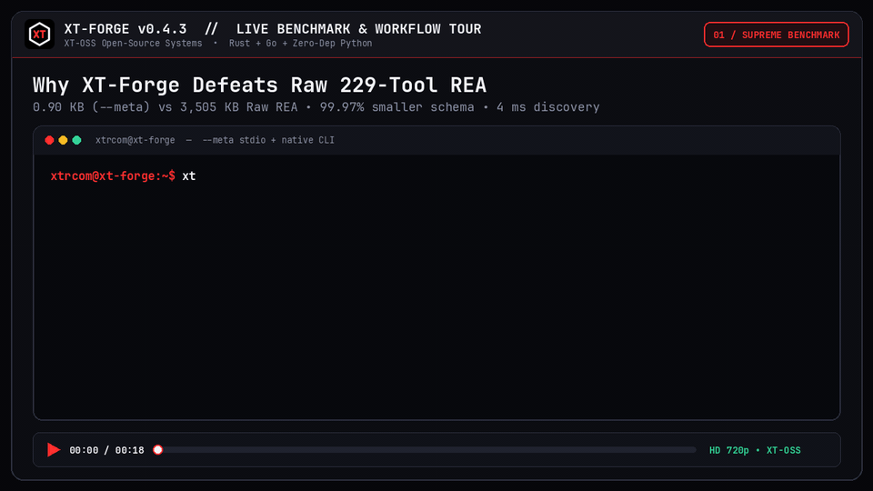

# XT-Forge Skill Suite (`XTF-*`)

XT-Forge ships **24 plain-named workflow skills** grouped into **Simple**, **Complex**, and **Advanced** tiers (8 per tier). Each skill states a one-line **Quick start** command up front alongside verification guardrails so both humans and coding agents know which command to run at first glance.

## Installation

Install all 24 skills alongside the `xt-forge` CLI and `/xtf` slash command in one step:

```sh
./install.sh
# or via npx directly from GitHub:
npx --yes github:XtrComSu/xt-forge init
```

Or run `./install.sh` (Linux/macOS) or `.\install.ps1` (Windows PowerShell) from a cloned checkout. To inspect the catalog directly from any terminal:

```sh
xt-forge skills
```

## Skill tiers

### Simple (8 skills)

Daily low-overhead habits for context discipline, AST correctness auditing, active dispatch tracing, quick navigation, secret safety, and fast vulnerability lookup.

| Skill | Job | Core commands | Source |
| --- | --- | --- | --- |
| **XTF-RepoMap** | Budgeted workspace map and slice peeks | `route context`, `route find`, `route grep`, `route peek` | [SKILL.md](../skills/simple/XTF-RepoMap/SKILL.md) |
| **XTF-CallGraph** | Symbol callers, outlines, and LSP queries | `code index`, `code graph`, `code callers`, `code outline` | [SKILL.md](../skills/simple/XTF-CallGraph/SKILL.md) |
| **XTF-CodeAudit** | Multi-file AST correctness & defect audit | `audit`, `code audit` (`code_audit` via `--meta`) | [SKILL.md](../skills/simple/XTF-CodeAudit/SKILL.md) |
| **XTF-DispatchTrace** | Active config & re-export runtime path tracer | `trace`, `code trace` (`code_trace` via `--meta`) | [SKILL.md](../skills/simple/XTF-DispatchTrace/SKILL.md) |
| **XTF-Notes** | Hot scratchpad state across turns | `flash set`, `flash pin`, `/mp`, `/mw`, `/mu` | [SKILL.md](../skills/simple/XTF-Notes/SKILL.md) |
| **XTF-SecretScan** | Pre-share secrets and injection defense | `scan secrets`, `scan injection`, `scan mcp` | [SKILL.md](../skills/simple/XTF-SecretScan/SKILL.md) |
| **XTF-LogCompress** | Log collapse preserving error traces | `compress L1`, `route errors` | [SKILL.md](../skills/simple/XTF-LogCompress/SKILL.md) |
| **XTF-CVELookup** | Keyless CVE, EPSS, and CISA KEV lookup | `intel cve`, `intel search`, `intel kev` | [SKILL.md](../skills/simple/XTF-CVELookup/SKILL.md) |

### Complex (8 skills)

Multi-step investigation loops across static binaries, normalized assembly diffs, polyglot LSP navigation, network indicators, packaged apps, and concurrent codebase research.

| Skill | Job | Core commands | Source |
| --- | --- | --- | --- |
| **XTF-BinaryTriage** | Offline ELF/PE hardening and capability audit | `re inspect`, `re checksec`, `re capa`, `re pe` | [SKILL.md](../skills/complex/XTF-BinaryTriage/SKILL.md) |
| **XTF-BinaryDiff** | Normalized instruction diffing, `.rodata` strings & reciprocal math decoding | `diff`, `re diff` (`re_diff` via `--meta`) | [SKILL.md](../skills/complex/XTF-BinaryDiff/SKILL.md) |
| **XTF-Disasm** | Disassembly, CFG, and C++ RTTI recovery | `re graph`, `re disasm`, `re cfg`, `re rtti` | [SKILL.md](../skills/complex/XTF-Disasm/SKILL.md) |
| **XTF-LSPNavigate** | Polyglot Go LSP stdio multiplexer & symbol refs | `code lsp`, `code outline`, `code refs`, `callers` | [SKILL.md](../skills/complex/XTF-LSPNavigate/SKILL.md) |
| **XTF-IOCIntel** | Extract binary IOCs and enrich upstream | `re ioc`, `intel ip`, `intel domain`, `intel hash` | [SKILL.md](../skills/complex/XTF-IOCIntel/SKILL.md) |
| **XTF-BinaryPatch** | Binary diffing and token-guarded patching | `re diff`, `re patch --dry-run`, `re patch --confirm` | [SKILL.md](../skills/complex/XTF-BinaryPatch/SKILL.md) |
| **XTF-Unpack** | Pure-Go ASAR, Android APK, and HAR/SAZ teardown | `re asar`, `re apk`, `re netcap` | [SKILL.md](../skills/complex/XTF-Unpack/SKILL.md) |
| **XTF-DeepResearch** | Parallel research across code, memory, and CVEs | `research run`, `search`, `mem put` | [SKILL.md](../skills/complex/XTF-DeepResearch/SKILL.md) |

### Advanced (8 skills)

End-to-end hardening, obfuscated binary recovery, high-concurrency binary MapReduce & MCTS solving, MCP schema trust enforcement, crash-safe call journaling, crash triage, and proof-gated loops.

| Skill | Job | Core commands | Source |
| --- | --- | --- | --- |
| **XTF-Decompile** | XOR/stack strings, headless decompile, safe trace | `re xor`, `re stack-strings`, `re decompile`, `re trace` | [SKILL.md](../skills/advanced/XTF-Decompile/SKILL.md) |
| **XTF-SwarmRE** | Parallel binary MapReduce & MCTS hypothesis solver | `swarm map`, `swarm mcts`, `re annotate` | [SKILL.md](../skills/advanced/XTF-SwarmRE/SKILL.md) |
| **XTF-MCPGateway** | MCP rug-pull audit, proxy, and sub-1KB gateway | `mcp audit`, `mcp proxy`, `xt-forge --meta` | [SKILL.md](../skills/advanced/XTF-MCPGateway/SKILL.md) |
| **XTF-SessionRecovery** | Crash-safe MCP call journal & idempotency recovery | `xt_call` (`idempotency_key` + `verify_tool`), `session list` | [SKILL.md](../skills/advanced/XTF-SessionRecovery/SKILL.md) |
| **XTF-BugFix** | Cross-module bug localization with scope checks | `code graph`, `goal check`, `goal verify` | [SKILL.md](../skills/advanced/XTF-BugFix/SKILL.md) |
| **XTF-CrashTriage** | Crash minidump postmortem and recon reporting | `re crash`, `re symbols`, `recon new`, `recon finding` | [SKILL.md](../skills/advanced/XTF-CrashTriage/SKILL.md) |
| **XTF-GoalLoop** | Bounded goal loops and daemonized monitors | `loop schedule`, `goal verify`, `guard status` | [SKILL.md](../skills/advanced/XTF-GoalLoop/SKILL.md) |
| **XTF-MemoryEval** | Memory linking, taste calibration, eval tracking | `mem link`, `taste learn`, `eval record` | [SKILL.md](../skills/advanced/XTF-MemoryEval/SKILL.md) |

## Overview


