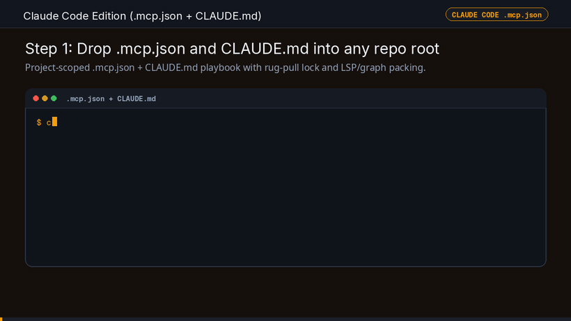

# xt-forge for Claude Code



Watch the full walkthrough: [claude-code-setup.mp4](claude-code-setup.mp4)

Claude Code supports project-scoped `.mcp.json` discovery and repository playbooks in `CLAUDE.md`. Using `--meta` exposes just four tools (`xt_discover`, `xt_schema`, `xt_call`, `xt_batch`) so you get full call-graph routing, reverse engineering, CVE intel, and anti-drift checks without bloating your context window.

## Quick Setup

1. Copy `.mcp.json` and `CLAUDE.md` into your target project directory (update `/path/to/xt-forge`):

```sh
cp integrations/claude-code/.mcp.json integrations/claude-code/CLAUDE.md /path/to/your/project/
```

2. Or register `xt-forge` at user scope via the Claude CLI:

```sh
claude mcp add xt-forge -- /path/to/xt-forge/bin/xtforge mcp serve --meta
```

3. Pin any external MCP servers you also run so silent schema changes are caught immediately:

```sh
./bin/xtforge mcp audit /path/to/xt-forge/adapters/mcp/server.py
./bin/xtforge mcp trust check --all
```

## Included Files

- [`.mcp.json`](.mcp.json): drop-in project MCP config using `--meta`
- [`CLAUDE.md`](CLAUDE.md): Claude Code project instructions covering symbol packing, RE workflows, and `goal verify`
- [`claude-code-setup.mp4`](claude-code-setup.mp4) and [`claude-code-setup.gif`](claude-code-setup.gif): visual walkthrough
