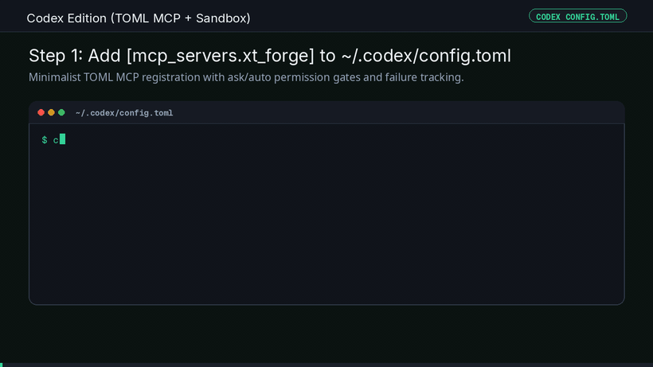

# xt-forge for Codex CLI



Watch the full walkthrough: [codex-setup.mp4](codex-setup.mp4)

Codex CLI connects cleanly via `~/.codex/config.toml` and reads project instructions from `AGENTS.md`. Wiring `xt-forge` in `--meta` mode gives Codex access to 56 tools while keeping the upfront schema down to 0.90 KB (~229 tokens).

## Quick Setup

1. Append [`config.toml`](config.toml) to `~/.codex/config.toml` (update `/path/to/xt-forge`):

```sh
cat integrations/codex/config.toml >> ~/.codex/config.toml
```

2. Copy [`AGENTS.md`](AGENTS.md) to your repository root (or merge into your existing `AGENTS.md`):

```sh
cp integrations/codex/AGENTS.md /path/to/your/repo/AGENTS.md
```

3. Verify Codex can reach the MCP gateway and test a read-only pass:

```sh
printf '{"jsonrpc":"2.0","id":1,"method":"tools/list"}\n' | ./bin/xtforge mcp serve --meta
./bin/xtforge guard mode explore
```

## Included Files

- [`config.toml`](config.toml): `[mcp_servers.xt_forge]` block with `--meta` and `XT_PERM_MODE=ask`
- [`AGENTS.md`](AGENTS.md): compact Codex workflow rules for call-graph context, negative memory, and verification
- [`codex-setup.mp4`](codex-setup.mp4) and [`codex-setup.gif`](codex-setup.gif): Codex setup walkthrough
