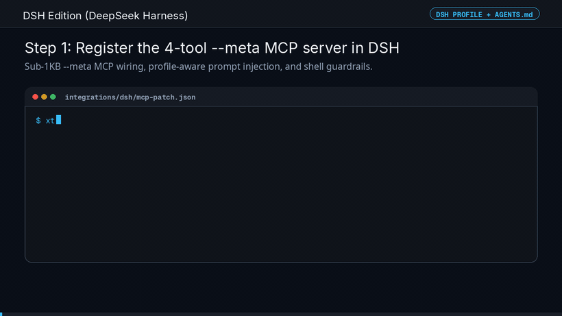

# xt-forge for DSH (DeepSeek Harness)



Watch the full walkthrough: [dsh-setup.mp4](dsh-setup.mp4)

This edition integrates cleanly with DSH (`cordis`) profiles and account-isolated harness workspaces.

## Why DSH users use this setup

- **No hallucinated tool names**: `xtforge prompt inject` inspects the active DSH profile and names the exact tools your session can actually invoke.
- **Account-aware safety guard**: the path allowlist resolves your real `$HOME` even when running under `~/.dsh/agy-accounts/<account>/`.
- **0.90 KB MCP schema**: mounting `xt-forge` with `--meta` keeps your DSH prompt clean while retaining access to all 56 tools.

## Quick Setup

1. Copy the DSH `AGENTS.md` template into your workspace root:

```sh
cp integrations/dsh/AGENTS.md /path/to/your/workspace/AGENTS.md
```

2. Add the MCP server block from [`mcp-patch.json`](mcp-patch.json) into your DSH MCP config (update the path to your local clone), then verify the live mount and token cost:

```sh
./bin/xtforge mcp status --probe
./bin/xtforge prompt inject
```

3. Lock down exploration sessions or allow gated edits:

```sh
./bin/xtforge guard mode explore   # read-only search, RE, CVE lookups
./bin/xtforge guard mode ask       # default: require confirm token on writes
./bin/xtforge guard mode auto      # allow edits inside allowlisted workspace
```

## Included Files

- [`mcp-patch.json`](mcp-patch.json): DSH / `cordis` MCP entry wired in `--meta` mode
- [`AGENTS.md`](AGENTS.md): concise DSH system instructions pointing at `./bin/xtforge`
- [`dsh-setup.mp4`](dsh-setup.mp4) and [`dsh-setup.gif`](dsh-setup.gif): visual setup walkthrough
