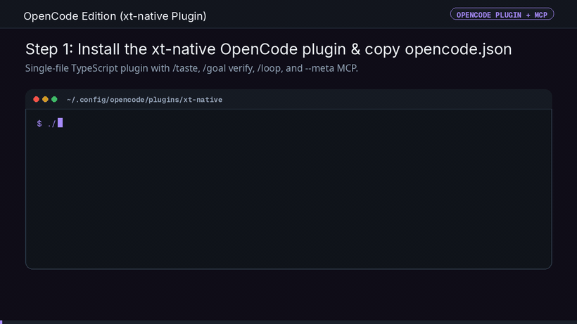

# xt-forge for OpenCode



OpenCode gets native slash commands (`/xtf`, `/taste`, `/goal`, `/loop`) via the single-file [`plugins/xt-native`](../../plugins/xt-native/) plugin alongside the 4-tool `xt-forge --meta` MCP gateway. The [OpenCode setup walkthrough](opencode-setup.mp4) walks through plugin installation and live hook capture alongside these steps.

## Quick Setup

1. Put `xt-forge` on PATH, sync `XTF-*` skills, and install the OpenCode plugin:

```sh
npx --yes github:XtrComSu/xt-forge init
xt-forge plugin install
xt-forge plugin status
```

2. Merge [`opencode.json`](opencode.json) into `~/.config/opencode/opencode.json`.

3. Use the slash commands directly inside OpenCode:

- `/xtf --meta | doctor | re checksec <bin> | intel cve <ID>`: invoke `xt-forge` directly from chat
- `/taste show | learn <rule> | why <id> | review`: deterministic preference memory (no LLM tokens used)
- `/goal record | status | check <cmd> | done`: rejects unverified `<goal-done>` claims
- `/loop | /loops | /loop-stop`: restart-safe bounded background schedules

## Included Files

- [`opencode.json`](opencode.json): OpenCode plugin + `xt-forge --meta` MCP configuration
- [`opencode-setup.mp4`](opencode-setup.mp4) and [`opencode-setup.gif`](opencode-setup.gif): OpenCode plugin walkthrough
- Source plugin: [`plugins/xt-native/`](../../plugins/xt-native/)
